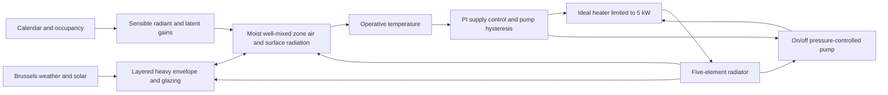

# BOPTEST-A — `bestest_hydronic` reference extraction

This is a **separate reference from the thesis Simulink model and the local EN 12831
room-builder draft**. No original upstream files were edited. No Simulink model, Python
physics, ML or web features are implemented here. No Modelica/FMU/MATLAB simulation
was executed, and no numerical equivalence or DIN compliance is claimed.

## Pinned evidence

- [BOPTEST](https://github.com/ibpsa/project1-boptest/tree/a29024f8c453517ccbd1186006a3fa6af8de1ae2):
  `a29024f8c453517ccbd1186006a3fa6af8de1ae2`, inspected 2026-10-28.
- [Primary TestCase.mo](https://github.com/ibpsa/project1-boptest/blob/a29024f8c453517ccbd1186006a3fa6af8de1ae2/testcases/bestest_hydronic/models/BESTESTHydronic/TestCase.mo),
  its wrapper, documentation, config, days/KPI files, resources and stored `wrapped.fmu`.
- [IDEAS build dependency](https://github.com/ibpsa/project1-boptest/blob/a29024f8c453517ccbd1186006a3fa6af8de1ae2/testcases/bestest_hydronic/models/library_versions.json):
  **`f1fdd8b22d39dc50297c47b6433e44381e40d0ff`**. Use this exact revision, not IDEAS
  main or merely the `2.2.1` version annotation in `BESTESTHydronic/package.mo`.
- [MSL v3.2.3](https://github.com/modelica/ModelicaStandardLibrary/tree/2da48301b8c3071158aa5ada8693767e6717ca47):
  `2da48301b8c3071158aa5ada8693767e6717ca47` inspected for inherited water and LimPID
  definitions. The upstream compiler-bundled MSL patch revision is **not recorded**;
  this selected canonical tag does not prove a bit-identical rebuild.

The machine-readable inventory is
[`configs/references/boptest_bestest_hydronic.json`](../configs/references/boptest_bestest_hydronic.json).
It records every extracted parameter's value, unit, explicit/derived status, expression
where derived, source file and line range or exact FMU XML XPath. Source records carry
commit-specific URLs and SHA-256 hashes. Unknowns are separate null-valued `unresolved`
records; they must never be loaded as physical defaults. This file is not an input to
the existing `load_config` or EN 12831 builder.

The stored FMU was inspected **as a ZIP/XML archive only**. It identifies JModelica.org,
FMI 2.0 and generation time `2024-09-14T01:07:17`. Exact constant/parameter declarations
in its XML supplement source evidence; state `start` guesses are not treated as solved
initial conditions. FMU/resource hashes in JSON distinguish this binary artifact from
future source recompilations. BOPTEST uses its BSD-style `license.md`; IDEAS/MSL have
their own licensing. Weather resources retain their original ASHRAE notices; no datasets
or third-party source files are copied into THERMA.

## Architecture and important corrections

1. **Not a generic BESTEST Case 900 parameter set:** top-level `mSenFac=1` and `n50=10`
   override the template's `0.822` and `0.822*0.5*n50toAch`. Use the actual testcase.
2. **No separate valve block:** prose mentions a thermostatic valve, but executable
   TestCase has radiator, heater, pressure pump and pressure boundary. Baseline switching
   acts on the pump. Do not invent a valve Kv, stroke or actuator time constant.
3. **Operative temperature is the comparison signal:** `TSensor = 0.5*TAir + 0.5*TRad`.
   Radiative temperature is a library-weighted surface temperature, not outdoor temperature
   or an extra arbitrarily chosen room state. Internal longwave exchange is linearised
   by default, while interior/exterior convection and opaque exterior longwave remain
   nonlinear. See the equation-source registry for exact defaults and implementations.
4. **Floor boundary is adiabatic at its outer side:** `BoundaryWall` has all of
   `use_T_fixed`, `use_T_in`, `use_Q_in` false and no external connected heat port there.
   Its layers still store heat. The dormant `T_fixed=294.15 K` is **not** an active
   ground temperature. Do not apply a floor U-value to outdoor air.
5. **Occupancy code differs from its comment:** the actual expression is one person
   when `hour<7 OR hour>19 OR weekDay>5`, otherwise zero. Thus weekday hours 7–19 have
   zero occupants; nights and weekends have one. Setpoint selection uses this value.
   Preserve that expression for replication; do not substitute a typical office schedule.

## Building and envelope parameters

Status: **E** = explicitly specified, including an identified inherited library default
or exact stored FMU parameter; **D** = arithmetic derived from these sources. Line-level
citations for every entry, including each layer field, are in the JSON `parameters` list.

| Parameter | Value | Unit | Status and source |
|---|---:|---|---|
| Length × width × height | 8 × 6 × 2.7 | m | E: IDEAS `Buildings/Validation/Cases/Case900Template.mo:5,33–34` |
| Floor / roof area | 48 / 48 | m² | D: template and `RectangularZoneTemplateInterface` geometry |
| Zone volume | 129.6 | m³ | D: 8×6×2.7; interface `V=A*h` |
| South glazing | 12 | m² | E: Case900Template; two physical 6 m² windows represented together |
| Opaque south / west / north / east areas | 9.6 / 16.2 / 21.6 / 16.2 | m² | D: gross face areas minus glazing; interface `AWall*Net` equations |
| Total opaque vertical area | 63.6 | m² | D: 2(8+6)2.7−12 |
| South azimuth | 0 | rad | E: IDEAS convention, west +π/2; not geographic north-zero |
| Window frame fraction | 0 | 1 | E: Case900Template `fracA=0` |
| Zone sensible mass multiplier | 1 | 1 | E: BOPTEST override; not the template's 0.822 or PartialZone's default 5 |
| Zone/fabric initial-temperature declaration | 293.15 | K | E: Case900Template `T_start` and component propagation; not a warmed-up state |

Layer order below is the construction-record order, exterior/boundary side to zone side.
All layer properties are E; areal resistance/capacity are D: `R''=d/k`, `C''=rho*c*d`.
Insulation values, including the unusual floor-insulation heat capacity, are kept as
specified rather than replaced with typical engineering values.

| Assembly / layer | d (m) | k (W/(m K)) | rho (kg/m³) | c (J/(kg K)) | R'' (m² K/W) | C'' (J/(m² K)) |
|---|---:|---:|---:|---:|---:|---:|
| Wall: wood siding | 0.009 | 0.14 | 530 | 900 | 0.064286 | 4293 |
| Wall: foam | 0.0615 | 0.040 | 10 | 1400 | 1.537500 | 861 |
| Wall: concrete block | 0.10 | 0.51 | 1400 | 1000 | 0.196078 | 140000 |
| Roof: deck | 0.019 | 0.14 | 530 | 900 | 0.135714 | 9063 |
| Roof: fiberglass | 0.1118 | 0.040 | 12 | 840 | 2.795000 | 1126.944 |
| Roof: plasterboard | 0.010 | 0.160 | 950 | 840 | 0.062500 | 7980 |
| Floor: insulation | 1.007 | 0.040 | 10 | 10 | 25.175000 | 100.7 |
| Floor: concrete slab | 0.08 | 1.130 | 1400 | 1000 | 0.070796 | 112000 |

Sources: IDEAS `Buildings/Validation/Data/Constructions/{HeavyWall,LightRoof,HeavyFloor}.mo`
and their referenced `Materials/` and `Insulation/` records, at the pinned revision.
All these opaque material records specify longwave emissivity 0.9 and shortwave
absorptivity 0.6. Full-precision numbers and per-material node-count derivations are in JSON.

| Assembly | Material-only R'' (m² K/W) | Material conductance G (W/K) | Stored fabric C (J/K) | Library design U (W/(m² K)) |
|---|---:|---:|---:|---:|
| Opaque walls, 63.6 m² | 1.797864146 | 35.375309171 | 9231794.4 | 0.509459609 |
| Roof, 48 m² | 2.993214286 | 16.036272521 | 872157.312 | 0.316634626 |
| Floor, 48 m² | 25.245796460 | 1.901306622 | 5380833.6 | Not an active outdoor heat-loss path |

Design wall/roof U uses the library's `1/(1/8 + R'' + 1/25)` expression. It is not the
instantaneous nonlinear convection/radiation model. Material G is `area/R''`, excluding
all films; the floor G describes its layers, not an external loss path. Total fabric C is distributed over
solid-layer states; **do not lump all of it into room air**. No unique one-node room
capacity or resistance is provided by the benchmark.

### Glazing and solar

`GlaBesTest.mo` specifies glass–air–glass thicknesses 0.003175 / 0.013 / 0.003175 m,
glass conductivity 1.06 W/(m K), glass longwave emissivity 0.9, rated U=3.0 W/(m² K)
and g=0.87. Inherited glass rho=2500 kg/m³ and c=750 J/(kg K) come from the Glass record.
The air gap is a gas layer with its own convection/radiation treatment; it is **not**
a simple static slab with R=d/k. Window dynamics use `Two`: a lumped glazing capacity,
with no frame contribution here (derived lumped glazing capacity 143068.41504 J/K).
Preserve the actual glazing model when matching solar.

The full angle-dependent `SwTrans` and per-layer `SwAbs` tables and diffuse values are
in JSON. Normal-incidence direct transmittance is 0.747454; diffuse transmittance is
0.652331. The rated g-value is not a replacement for those tables. Source angle grids are in
degrees; convert interface angles consistently from radians for lookup. The unusual source
absorption entry at 89.5° is retained, not silently corrected. No active shading is
specified by the testcase's default shading properties.

Outdoor surface solar absorption, sky/ground longwave exchange, angle-dependent glazing
transmission/absorption and interior gain distribution all matter. Direct transmitted
solar is preferentially distributed to the floor using the source's absorption weights;
diffuse solar and longwave internal gains use different surface weights. Simply injecting
`g*window_area*horizontal_solar` into room air does not reproduce this model.

### Infiltration and gains

| Parameter | Value | Unit | Status / source |
|---|---:|---|---|
| n50 / conversion factor | 10 / 20 | h⁻¹ / 1 | E: TestCase override / PartialZone default |
| Operating infiltration | 0.5 | h⁻¹ | D: n50/20 with default `InterzonalAirFlow.Sim` path |
| Operating volumetric flow | 0.018 | m³/s | D: 129.6×0.5/3600 |
| Operating air mass flow | 0.018×rho_default | kg/s | Unresolved numeric value; density is from the specified moist-air medium |
| Sensible / latent gain per person | 73 / 45 | W/person | E: `OccupancyType.OfficeWork` |
| Radiant share of sensible gains | 0.6 | 1 | E: same record |
| Convective / radiant sensible gain when one person | 29.2 / 43.8 | W | D: 73×0.4 / 73×0.6 |
| Lighting gains | 0 | W | E/derived default: LightingType.None, infinite efficacy |
| Occupancy calendar | NY2019 | epoch selector | E: TestCase CalendarTime |

No separate mechanical-ventilation plant is specified. Moist-air mass/enthalpy,
water-vapour and CO₂ balances are present; 45 W latent is not another 45 W of direct
sensible room heating. The n50 value is a pressure-test metric, not 10 operating ACH.
Confirm initialized n50_int and default medium density before exporting a numeric mass
flow or fixed room-air capacity. Do not substitute a typical air density/cp.

## Hydronic system and controls

| Parameter | Value | Unit | Status / source |
|---|---:|---|---|
| Radiator / heater nominal or maximum power | 5000 / 5000 | W | E: TestCase `rad.Q_flow_nominal`, `hea.QMax_flow` |
| Nominal inlet / outlet / room temperatures | 343.15 / 323.15 / 293.15 | K | E: TestCase 70/50°C rating and RadiatorEN442_2 default room |
| Water cp / density | 4184 / 995.586 | J/(kg K) / kg/m³ | E: inherited ConstantPropertyLiquidWater; FMU cp corroborates |
| Nominal mass flow | 0.0597514340344 | kg/s | D: 5000/(4184×20); stored FMU exact constant agrees |
| Radiator elements | 5 | 1 | E: RadiatorEN442_2 default |
| Radiant fraction / exponent | 0.35 / 1.24 | 1 / 1 | E: radiator defaults |
| Radiator water volume | 0.029 | m³ | D: 5.8e−6×5000 |
| Radiator dry mass | 131.5 | kg | D: 0.0263×5000 |
| Metal cp built into storage formula | 500 | J/(kg K) | E: radiator `mSenFac` formula |
| Radiator energy dynamics / initial T declaration | FixedInitial / 293.15 | enum / K | E: TestCase and stored FMU parameter |
| Pump head / radiator nominal pressure drop | 100000 / 100000 | Pa | E: TestCase and `rad.dp_nominal=pump.dp_nominal` |
| Heater nominal pressure drop | 0 | Pa | E: all resistance intentionally merged into radiator |
| Pump hydraulic / motor efficiencies | 0.7 / 0.7 | 1 | E: defaults and FMU metadata; product 0.49 is D |
| Pump input filtering / power to fluid | false / false | 1 | E: TestCase |
| Absolute pressure boundary | 300000 | Pa | E: stored FMU `mod.bou.p`; not pressure drop |
| Unoccupied / occupied heating target before offset | 288.15 / 294.15 | K | E: 15/21°C TestCase |
| Unoccupied / occupied cooling target | 303.15 / 297.15 | K | E: 30/24°C TestCase; no physical cooler installed |
| Heating target offset | 0.1 | K | E: TestCase; applied before heating overwrite |
| Supply PI gain / integration time | 10 / 300 | 1 / s | E: TestCase LimPID |
| Supply setpoint limits | 293.15–353.15 | K | E: 20–80°C TestCase |
| PI anti-windup Ni / initial integrator state | 0.9 / 0 | 1 / 1 | E: inherited LimPID, corroborated stored FMU |
| Pump hysteresis memory start | false | Boolean | E: HysteresisRelease default; initialization events can change output |

The 70/50°C pair is a **rating condition**, not the time-varying operating supply/return.
The pump prescribes stage-dependent pressure (single on stage from default speeds),
with no input filter; loop resistance gives the flow. No independent pump curve or
pipe geometry needs to be invented. At small flow, preserve the pressure-drop model's
regularisation, not only its nominal quadratic relation.

The heater is an ideal, **heating-only** prescribed-outlet component with 5 kW capacity
and steady-state energy dynamics. It may not attain the supply target under load.
It is not a boiler/tank storage model. Water is incompressible with constant properties;
IDEAS makes `h=u=cp*(T−273.15)`.

The radiator has five serial mixing volumes. Effective storage is
`rho*VWat*cp + 500*mDry` (about 186550.423 J/K total, distributed across five elements).
For each element, separate convective and radiative emission depends nonlinearly on
the difference to air and radiative surface-node temperatures. `UAEle` is solved from
nominal rating initial equations, **not** assigned as `5000/(60−20)` and not obtainable
from an FMU numeric start guess. Preserve `regNonZeroPower(...,delta=0.05)` and rating
`powerLinearized` handling. Library radiator heat flows are positive **into water**;
heat supplied to the room has the opposite sign.

Controller reproduction requires the actual occupied flag, offset, event inequalities,
LimPID anti-windup, saturation and initialization:

- PI tracks operative temperature against the heating target plus 0.1 K by default.
- Pump state is `T_op < heating_target OR (pre(on) AND T_op <= cooling_target)` with
  `revert=true`. It therefore stays on until exceeding the **cooling** threshold, not
  a guessed small symmetric thermostat deadband. No cooler is activated by that label.
- `ovePum` feeds RealToInteger then the pump stage; use binary 0/1 for replication.
- Gas power is `hea.Q_flow/eta`. Eta is the source sixth-order polynomial of the
  **pump heat-port temperature in °C**, clipped to [25,75] before evaluation. Do not
  add an efficiency clamp absent from source or assume a fixed efficiency.

## Weather, resources and initialization

Active default weather is IDEAS `Resources/weatherdata/Brussels.mos`: latitude 50.90°,
longitude 4.53°, timezone +1 h, elevation 58 m. The TestCase string loading `Uccle.TMY`
only ensures resource packaging; it does not set `sim.filNam`. Do not replace weather
with Germany's climate while claiming this is the same benchmark.

The stored FMU contains that exact IDEAS Brussels file (SHA-256
`809d9b66b5283202d3dcaf05c6bb3db448ca94e7d6017740cacd75da537ee12b`) and Uccle.TMY.
The testcase's `Resources/Brussels.mos` has a different byte hash but matches the IDEAS
file after stripping trailing whitespace. Both file identities are recorded separately.
Forecast `weather.csv` and `dataFromModel.csv` exist both in the source tree and FMU;
byte hashes differ. A static numeric comparison found only rounding-scale differences
(e.g. weather solar time up to about 5e−5 s). For exact repeatability choose and hash
one resource set, preferably the stored FMU's when using that FMU.

Resource CSVs have 35041 data rows, from 0 through 31536000 s at 900 s spacing.
`dataFromModel.csv` contains occupancy, comfort bounds and gains, **not** a validation
trajectory of the Simulink reconstruction. Comfort `LowerSetp`=21/15°C differs from the
controller's +0.1 K heating offset; retain that distinction. The generator still refers
to old `reaTSetHea`/`reaTSetCoo` names absent from the current model: do not run it blindly.

Zone/fabric and radiator declared initial temperatures are 293.15 K. Moisture, CO₂,
PI and hysteresis states and Modelica's coupled initialization need a consistent FMU
initialization, not only temperature assignments. A warmed-up state differs from those
declarations. Preserve the NY2019 calendar and the benchmark's model-time convention;
record any conversion between the BOPTEST clock and Simulink time, including warm-up.

## Equations and staged Simulink architecture (proposal only)

Source locations are in JSON `equation_sources`; the full functions remain authoritative.
The following is a dependency map, not a claim that a simple RC model is equivalent:

| Stage / block | Needed physics and dependencies | Verification before proceeding |
|---|---|---|
| 0. Inputs and registry | Fixed source/FMU/resource hashes; weather reader, solar geometry, calendar, occupancy and control override flags | Match boundary inputs and switch events before comparing temperatures |
| 1. Envelope layer chains | One-dimensional conduction: `rho*c*dT/dt = k*d²T/dx²`; source finite-volume/node conductances and capacities | Material R/C totals, state discretization and surface heat-flow signs |
| 2. Surface exchange and window | Nonlinear interior convection, wind/temperature exterior convection, configured longwave models, glazing gas-gap exchange, optical interpolation and solar distribution | Preserve facade orientations, area bookkeeping and adiabatic floor back boundary |
| 3. Zone air and operative output | Moist-air enthalpy/mass balance, infiltration, humidity/CO₂, sensible and radiative gain split; `T_op=(T_air+T_rad)/2` | Free-floating response, separate air/surface temperatures, latent handling and energy residuals |
| 4. Hydronic circuit | Five water/metal storage nodes: advection plus convective/radiative exchange; regularized radiator resistance; pressure pump and reference boundary; limited ideal heater | Nominal flow, no-flow residual heat, radiator rating calibration, water/room energy cancellation |
| 5. Baseline control and KPIs | Exact LimPID and pump hysteresis, overwrite selection, gas efficiency and electrical pump power | Same initialization, inputs, event times, occupied flags and measured variables |

`MonoLayerDynamic.mo` distributes total `A*rho*c*d` over its states and chooses conductance
segments so total resistance remains `R''/A`. Source node counts, surface-state merging
and endpoint capacities matter. Do not independently add duplicate capacities at shared
layer interfaces. Interior convection for vertical surfaces scales as sign(ΔT)|ΔT|^1.293;
horizontal cases use buoyancy-dependent powers/splicing. Replacing these with a single
fixed film coefficient is a labelled reduction, not source-faithful reproduction.

A lower-order version may later combine fabric nodes, use dry-air sensible-only dynamics,
constant surface coefficients, simpler solar gains, one radiator water node and prescribed
flow. Each choice removes source dynamics/physics. Keep such a version separately named,
quantify its error against the full reference and do not call it a reimplementation of
BESTEST Case 900 without qualification. The existing local two-state room-builder does
**not** implement this benchmark and must not receive this JSON as though it did.

## Quantitative comparison plan

Public BOPTEST wrapper measurements at the pinned commit:

| Measurement / input | Meaning | Comparison warning |
|---|---|---|
| `reaTRoo_y` [K] | Operative zone temperature | Not room air; air/surface temperatures require extra internal logging |
| `reaQHea_y` [W] | **Gas input power**, wired to `QGas=hea.Q_flow/eta` | Its description says heating thermal power; do not compare directly to radiator heat |
| `reaPPum_y` [W] | Pump electrical power | Separate from heater thermal and gas powers |
| `reaCO2RooAir_y` [ppm] | Zone CO₂ concentration | A dry thermal reduction cannot claim to reproduce it |
| `weaSta_reaWea*` | Weather/solar boundary measurements | Verify the same active weather, interpolation and time origin |
| `oveTSetSup_u`, `ovePum_u` and paired `_activate` | Supply K [293.15,353.15], pump stage [0,1] | Activation false uses baseline; on/off stages only for deterministic pump tests |
| `oveTSetHea_u`, `oveTSetCoo_u` and paired `_activate` | Operative heating/cooling targets K [278.15,308.15] | Not physical cooling actuation; overwriting heating bypasses the upstream offset |

`kpis.json` maps operative temperature, gas power, electric power and CO₂ to BOPTEST KPIs.
The runtime public measurements do not directly expose radiator return temperature,
water mass flow, radiator heat, air temperature or surface states. Request internal FMU
logging or a separately identified instrumented reference for those comparisons; do not
invent public REST signal names. No instrumentation is changed in this phase.

| Existing scenario | Evaluation window | Baseline warm-up | Source |
|---|---|---|---|
| `peak_heat_day` | Day 311 to 325 (center day 318) | 7 days before evaluation start | `days.json`, `testcase.py` |
| `typical_heat_day` | Day 334 to 348 (center day 341) | 7 days before evaluation start | Same |

Scenario windows are fourteen days; their names do not mean a one-day evaluation.
Standalone config defaults are start=0 s, warm-up=0 s, API step=3600 s. Resource interval
900 s, the model's 604800 s/Dassl experiment annotation, runtime output sampling and
adaptive integration are distinct settings. `testcase.py` requests roughly 30 s result
communication points for sufficiently long steps; it is not a 30 s integration-step rule.
Actual solver/tolerances depend on runtime options and must be recorded in a later run.

Proposed comparison sequence: (1) existing baseline with all overrides disabled;
(2) controlled open-loop pump/supply experiments within documented input bounds to isolate
hydronics; (3) complete peak/typical baseline scenarios with identical warm-up, boundary
series and sampling. New open-loop experiments are proposals, not existing validated
BOPTEST scenarios. Free-floating/envelope tests need careful removal of stored radiator
heat and consistent initial conditions; pump-off alone is not an unheated building.

Use temperature RMSE/MAE/max error in K, energy-integral errors in J/kWh, peak powers,
comfort degree-hours against supplied bounds, event timing and energy/mass residuals.
Choose acceptance thresholds only after solver convergence and reference run resolution
are established. Weather forecasts and generated gain schedules are not measured ground
truth. Runtime/accuracy/speed improvements are unmeasured.

## Unresolved items and next milestone

The extraction resolves the major physical declarations and dependency equations, but
not a complete numerically initialized equivalent model. JSON lists the unresolved
items explicitly: single-RC reduction, moist-air capacity and infiltration mass flow,
radiator calibrated UAEle, operating temperatures, full initialized states, runtime
solver options, exact compiler-bundled MSL revision and future acceptance thresholds.
A valve/pipe specification cannot be recovered because those separate components are
not present in this executable testcase.

**Recommended next step:** review the extracted parameter and equation contract, then
establish a reproducible BOPTEST baseline and agree envelope discretization/measurement
mapping before building Simulink. Implement boundary/weather replay and the layered
building envelope first, with the hydronic circuit as a later separately checked stage.
A BOPTEST result file and MATLAB run are prerequisites for claiming quantitative agreement.
No original thesis parameters, invented typical values or DIN calculations are substituted.
