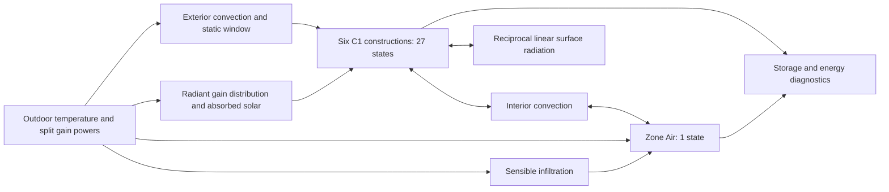

# C2 reduced thermal zone — implementation and MATLAB handoff

Status: **scripts prepared; MATLAB generation and execution pending**. This is a
physically conservative reduced dry-air model, not an exact reconstruction of
BESTEST Hydronic. C1 success on R2025a is user-reported; see the evidence boundary
in [the audit](SPRINT_AUDIT.md). No local C2 outputs have been supplied or fabricated.

## Reference identity and explicit parameter choices

The C1 loader still verifies registry SHA-256
`f91141d78668908525d484a4900dc69af1a163c4c5e07f5a5fbd0c43eae4451c`.
It retains BOPTEST `a29024f8c453517ccbd1186006a3fa6af8de1ae2` and IDEAS
`f1fdd8b22d39dc50297c47b6433e44381e40d0ff`. Exact source paths, line anchors
and derived expressions remain in the frozen registry and
[BOPTEST_REFERENCE.md](BOPTEST_REFERENCE.md).

`load_boptest_zone_parameters` requires an explicit assumptions-file argument.
It never substitutes missing fields. The supplied
[c2_reduced_assumptions.json](../configs/references/c2_reduced_assumptions.json)
is an engineering fixture with deliberately **provisional** values, not new reference
facts or calibrated coefficients. Its full contents and byte hash accompany reports.

| Parameter | Value / unit | Source and status | Used by |
|---|---|---|---|
| Volume | 129.6 m³ | `building.volume`, derived from 8×6×2.7 | Air storage |
| Opaque face areas | 9.6,21.6,16.2,16.2,48,48 m² | `building.*_area`, derived geometry | Exchange and gains |
| Layer properties and 27 states | Unchanged C1 | `wall/roof/floor.layer*`, reference and derived | Envelope |
| Initial temperature | 293.15 K | `building.initial_temperature`, reference | All dynamic states |
| Air density | 1.2 kg/m³ | Explicit provisional constant dry-air assumption | Storage/infiltration |
| Air cp | 1006 J/(kg·K) | Explicit provisional dry-air assumption | Storage/infiltration |
| Air capacity | rho×cp×V = 156453.12 J/K | Derived from provisional properties | Zone Air |
| Interior h | 3 W/(m²·K) | Provisional constant; source nonlinear | Interior convection |
| Exterior h | 15 W/(m²·K) | Provisional constant; source nonlinear/wind-dependent | Opaque exterior convection |
| Radiation h | 4 W/(m²·K) | Provisional reciprocal linear network | Opaque interior radiation |
| Window U | 3 W/(m²·K) | `window.U_rating`, reference **rating** | Static reduced window |
| Window area / UA | 12 m² / 36 W/K | Reference area; derived UA=U×A | Static window |
| Leakage volume flow | 0.018 m³/s | `infiltration.volume_flow`, derived source ACH×V/3600 | Sensible infiltration |
| Leakage mass flow / conductance | 0.0216 kg/s / 21.7296 W/K | Derived using provisional rho/cp | Sensible infiltration |
| Radiant distribution | A_i/sum(A), dimensionless | Provisional area rule, derived weights | Radiant heating/internal gains |
| Solar absorption per face | Explicit input W | Unresolved exact optics; externally prescribed absorbed power | Surface nodes |
| Exact moist-air capacity | Unresolved | `air.effective_capacity` | Exact-reference follow-up |
| Exact view factors, surface h, longwave sky coupling | Unresolved implementation | Source flags `surfaces.*`; exact algorithms not ported | Exact-reference follow-up |
| Dynamic glazing and solar optics | Unresolved implementation | Extracted optical tables and glazing properties | Exact-reference follow-up |

No physical value in the frozen registry is changed. The room is not a one-node
lumped-fabric RC model: 27 material states remain independently integrated.
The table's calculated air and leakage values describe this reduced fixture only.

## Architecture and state ownership



`THERMA_BOPTEST_ThermalZone_C2` is separate from C1. It directly reuses
`add_boptest_construction` without duplicating conduction equations. Editable
subsystems implement each solid, Zone Air and each interior/exterior exchange,
Static Window and Ventilation Infiltration. Radiation and gain distribution are
explicit matrix/Gain/Sum blocks. No empty placeholder optical/weather subsystem
implies that those missing physics have been implemented.

State vector: all exterior-to-interior C1 nodes in south/north/east/west/roof/floor
order, followed by air temperature: **28 free dynamic states**. Both surface
endpoints of every solid remain dynamic, including the insulated floor back.
No C2 state is imposed by outdoor temperature. The prescribed outdoor input belongs
to a thermal reservoir coupled through convection. The fixed-temperature fixtures
used in C1 verification are separate and not reused as physical C2 components.
Algebraic variables include surface exchanges, radiation, gain distribution,
window/infiltration power and energy diagnostics. No glazing dynamic states exist.
A future Python port can retain this indexing and nodal balance, but no Python
thermal solver is introduced here.

## Equations and signs

Use kelvin, watts, joules and seconds. Every boundary power is positive **into** the
included system. Interior convection is `q_conv_i=h_in*A_i*(T_air-T_surface_i)`,
positive from air into solid i. Opaque exterior convection is
`q_ext_i=h_ext*A_i*(T_out-T_exterior_i)` for walls/roof only.
The floor back power is exactly zero.

For i≠j, reciprocal radiation conductance is
`G_ij=h_rad*A_i*A_j/sum(A)`; `G_ii=0`. The power into surface i is
`sum_j G_ij*(T_j-T_i)`. Symmetry ensures pairwise energy cancellation. This is a
linearized engineering approximation, not the reference view-factor algorithm.
Radiant heating and internal gains are distributed using weights `A_i/sum(A)`.
The six supplied absorbed solar powers enter their corresponding interior material
nodes. Neither radiation nor solar is silently deposited in air.

For each interior surface, add convection, radiation exchange, distributed radiant
gains and absorbed solar to the original C1 boundary input. Air obeys:

`C_air*dT_air/dt = Qheat_conv + Qinternal_conv + Qvent + Qwindow - sum(q_conv_i)`.

`Qvent = rho*cp*volume_flow*(T_out-T_air)` is fixed sensible infiltration; no separate
ventilation path double-counts the same flow. A future explicit mechanical-air stream
needs its own mass flow and inlet state. `Qwindow=UA_window*(T_out-T_air)` is a
static aggregate window path. Its rated U includes surface effects; it receives no
additional films or parallel glazing path. Window storage, window radiant exchange,
solar optical processing and exterior longwave radiation are omitted.

Total storage is all C1 stored energies plus `C_air*(T_air-293.15)`.
The external system power is:

`Qnet=sum(q_ext)+Qvent+Qwindow+Qheat_conv+Qheat_rad+Qinternal_conv+Qinternal_rad+sum(Qsolar)`.

Internal convection and radiation cancel from this boundary. `dE_dt` uses the
actual block derivative signals; `residual_W=dE_dt-Qnet`. Heating is counted once.
No gas-input-to-room-heat conversion is assumed.

## Inputs, outputs and scenarios

One root Inport `Inputs` carries 11 values in this exact order:

1. Outdoor air temperature [K].
2. Heating convective delivered power [W].
3. Heating radiative delivered power [W].
4. Internal convective sensible power [W].
5. Internal radiative sensible power [W].
6. Six absorbed interior solar powers [W], south/north/east/west/roof/floor.

Positive powers add heat; negative powers explicitly remove heat. Heating availability
must be applied to delivered power by the driving experiment/controller. Supply and
return water temperatures have no zone input in C2.

Root outputs and Timeseries logs are `T_air_K`, `T_interior_K[6]`,
`T_exterior_K[6]`, `q_exterior_W`, `q_air_to_surfaces_W`, `q_vent_W`,
`q_window_W`, `q_heating_W`, `q_internal_W`, `q_solar_W`, `E_J`, `dE_dt_W`,
`q_net_W`, `residual_W`, `T_states_K[28]`, `T_opaque_mean_K`, and
`q_radiation_exchange_W[6]`. `T_opaque_mean_K` is an area-weighted diagnostic;
it is **not** source TRad or operative temperature.

`boptest_zone_scenarios` separately defines equilibrium, cold outdoors, constant
heating, heating step, shutdown, outdoor step, internal gain step, absorbed solar
step, warm inlet and initial surface perturbation. Test amplitudes (e.g. 10 K,
1000 W) are controlled synthetic excitations, not reference operating conditions.
Signals are right-continuous zero-order holds, with event at 3600 s in 7200 s runs.
The builder's default ode15s settings are RelTol 1e-7, AbsTol 1e-9 K, MaxStep 30 s.
They are numerical starting choices, not measured reference accuracy.

## Verification and diagnostics

`verify_boptest_zone_c2` updates the generated model and checks 28 Integrators.
Each scenario runs ode15s at 1e-7/1e-9/30 s, then 1e-8/1e-10/15 s.
An independently assembled 28-node conductance network propagates each constant-input
interval with an augmented matrix exponential. It checks **all states** against the
generated blocks, not just whether the solver finishes. This analytical network is
MATLAB verification code, not another simulation product or BOPTEST validation.

Checks include equilibrium, temperature finiteness, warming/cooling direction,
ventilation formula for warm/cold conditions, surface convection formula,
heating/internal/solar input accounting, reciprocal radiation cancellation, stored
energy identity, derivative power balance and integrated energy balance. The MATLAB
parameter test checks stability, uniform equilibrium, reciprocal exchanges, per-W
input conservation and the absence of direct radiant inputs to the air node.

A 20×(AbsTol+RelTol×Tmax) temperature diagnostic budget is recorded; it is a
heuristic, not a rigorous solver-error bound or building accuracy criterion. Energy
bounds follow from capacities, boundary conductances and duration. Power roundoff
budget is 512 ULPs on the absolute-temperature conductance-product scale to include
cancellation in radiation matrix arithmetic. Tolerances are fixed in code, not
adjusted dynamically to pass failures.

Reports retain raw sampled trapezoidal energy residual, independently calculated
same-grid analytical quadrature bias, corrected residual and relative residual.
The raw residual at switching events is not silently treated as solver error.
Refined maximum analytical temperature error must not increase beyond 64-ULP
roundoff. Coarse/refined discrepancies are also reported (linear interpolation of
continuous temperature only). A failed convergence check must be investigated.

Unique ignored output directories hold model, parameter/build JSON, per-case coarse
and refined CSVs, six-panel plots and partial `verification.json` reports. Plots show
air/surface temperatures, heating, envelope power, power residual and solver overlays.
Completed coarse CSVs survive a later refined-run failure. Reports include MATLAB,
Simulink, model version, source file hashes, registry hash, assumptions/hash, numerical
settings, metrics and failure descriptions. Only actual successful MATLAB execution
can set `matlab_verified=true` for C2.

## University MATLAB R2025a commands

Download the complete working snapshot, including new assumption JSON, MATLAB scripts
and tests. MATLAB with Simulink and the normal JVM is required; no Simscape toolbox
is needed. In MATLAB set your actual repository root, then run:

```matlab
cd('C:\YOUR\PATH\THERMA');  % replace this example path
addpath(fullfile(pwd,'scripts','matlab','boptest'));
results = runtests('tests/matlab');
assertSuccess(results);
assumptions = fullfile(pwd,'configs','references','c2_reduced_assumptions.json');
Z = load_boptest_zone_parameters(assumptions);
reportFile = verify_boptest_zone_c2(assumptions);
report = jsondecode(fileread(reportFile));
disp(report.status);
```

After verification, generate/open a separate editable model:

```matlab
[model, modelFile] = build_boptest_zone_c2(assumptions);
disp(modelFile);
open_system(model);
```

The default model expects the 11-element input above; use the verification runner
for complete scripted input scenarios rather than clicking Run with unconnected
inputs. To reproduce the C1 suite independently, first save/close generated models
with the same name, then run `verify_boptest_envelope_c1()`.

The C2 verifier creates plots automatically. Inspect `verification.json`, each case's
metrics and CSVs and `diagnostics.png`. An error is accompanied by a partial report;
return that directory and the generated build/parameter files. Static checks here
cannot guarantee R2025a block/API execution. If a same-name model is already loaded,
save and close it yourself; scripts do not overwrite it. Every build saves a new
`outputs/boptest/simulink_c2/<unique>/` directory. Do not commit generated artifacts.

Headless execution from the repository root:

```sh
matlab -batch "addpath(fullfile(pwd,'scripts','matlab','boptest')); verify_boptest_zone_c2(fullfile(pwd,'configs','references','c2_reduced_assumptions.json'));"
```

## Remaining gates

Run and review local C2 verification first. Then resolve source moist-air storage,
nonlinear surface exchange, full glazing/solar and sky-longwave behaviour before
attempting faithful original-FMU weather/gain replay. Heating replay must retain
convective/radiative splits and full warm-up. See [comparison contracts](REFERENCE_COMPARISON.md)
and [C3 readiness](C3_READINESS.md). No hydronic network is implemented in this sprint.
