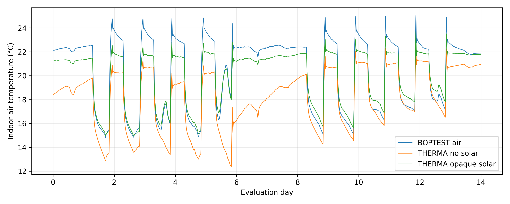
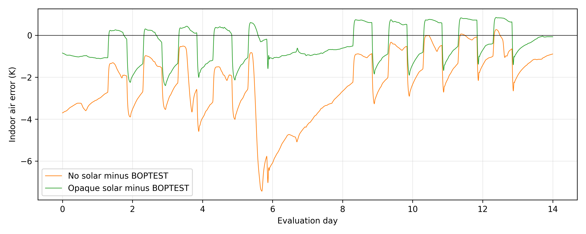
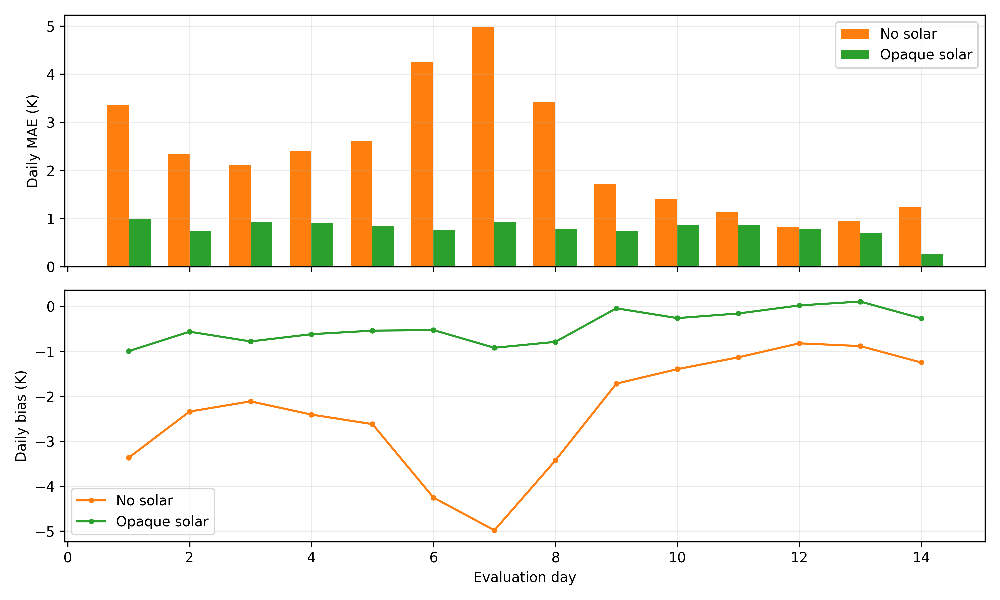
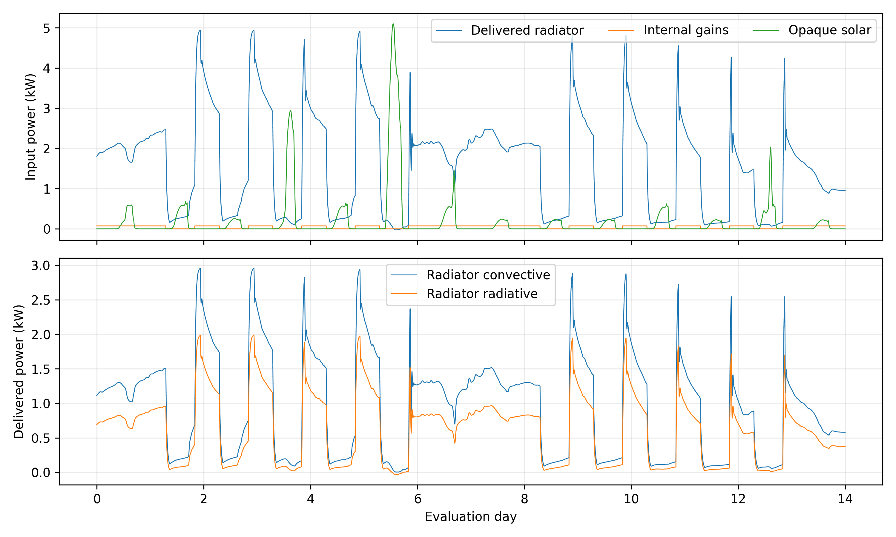
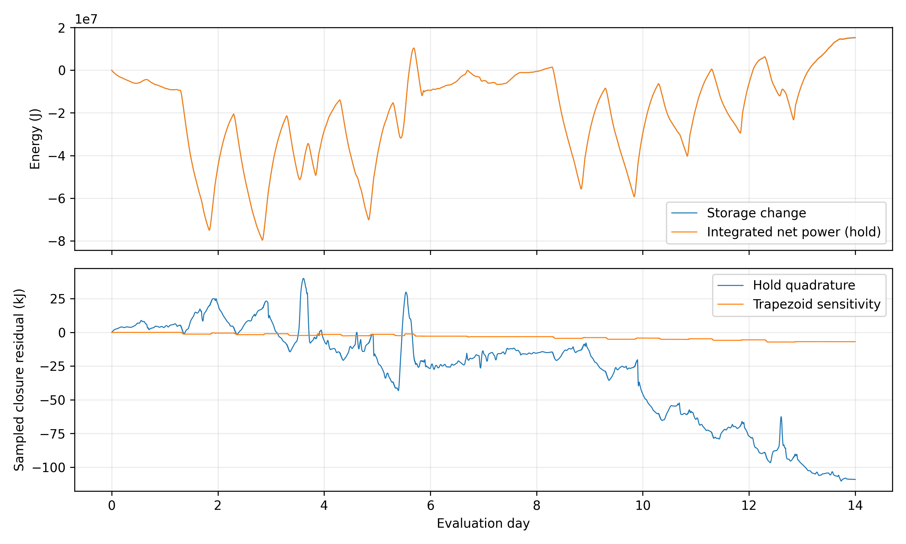

# C2.6C engineering report — actual R2021a solar replay

THERMA’s agreement with the pinned BOPTEST indoor-air trajectory improved substantially: **MAE 2.34053 → 0.79253 K (66.14% lower)** and RMSE 2.80550 → 0.92398 K. Daily MAE improved on all 14 evaluation days. This is an exploratory partial-model benchmark, **not real-world validation**, calibration or evidence of energy savings.

## Evidence and execution environment

The user executed the solar-resolved model on the university PC using **MATLAB 9.10.0.1602886 (R2021a), Simulink 10.3 (R2021a)**. This is confirmed by the actual replay_run.json, despite the delivery package targeting R2025a. The preserved no-solar baseline was executed on R2025a. Codex did not execute MATLAB. The user reports **14/14 MATLAB tests passed**; no separate test log was supplied, so this count remains user-reported evidence. The replay report confirms completed execution and export. Its `matlab_verified:false` flag is preserved, not relabeled as reference validation.

All three required uploads were copied unchanged to ignored outputs/boptest/replays/c26_solar_actual/. CSV SHA-256 matches the supplied metadata. File identity is checked before and after analysis. The optional simulation.mat could not be downloaded because it exceeds the tool’s 32 MiB limit; no MAT data was read or reconstructed. CSV/JSON exports supply the required analysis signals.

| Original supplied file | Bytes | SHA-256 |
|---|---:|---|
| evaluation.csv | 13,537,973 | `b1c340ae56d42877ff000104f921dc42f43faa41f040f7e5c1a9230e6255cb0d` |
| comparison_metadata.json | 2,695 | `d45f35a876d5de0c1b566616b19072f89d4ae0a5c6e743fa30153ca774e012d2` |
| replay_run.json | 61,677 | `7b667c10124021c156f0a69f603acec2b8b4a016746d070d32b13261588d61d9` |

Full provenance and original baseline hashes: [provenance.json](results/c26c/provenance.json). The new report’s replay-driver hash equals the repository source hash. Frozen registry, explicit assumptions and model version equal the baseline. The original packet hash matches exactly. MATLAB’s embedded JSON changes invalid field-name characters to underscores, truncates field names at 63 characters and writes null as an empty array; these known round-trip effects were explicitly checked against the original hash-matched packet, without modifying either input.

## Reference, time alignment and comparison method

- Model: THERMA_BOPTEST_ThermalZone_C2, C2-reduced-v1; unchanged reduced thermal physics.
- Reference: bestest_hydronic, typical_heat_day; BOPTEST `a29024f8c453517ccbd1186006a3fa6af8de1ae2`, IDEAS `f1fdd8b22d39dc50297c47b6433e44381e40d0ff`.
- Original FMU SHA-256: `365b3085d97cc4620c06b6036156126a056d7f160fcc4f181d6b2fac4b05743b`.
- Seven-day warm-up begins at 28,252,800 s; evaluation is 28,857,600–30,067,200 s (14 days), with no evaluation-start reset.
- New export: 59,292 finite, strictly increasing adaptive evaluation samples, 0.2686803–30 s spacing. Baseline: 58,008 samples. No duplicate timestamps or extrapolation; exact evaluation endpoints are present.
- Metrics use **40,321 native reference timestamps at 30 s**, with linear interpolation of continuous candidate air temperature. Warm-up is excluded; errors are not weighted by adaptive solver sample density.
- Target is `mod.case900Template.TAir` in K, not operative temperature `reaTRoo_y`. Bias is THERMA minus BOPTEST. Maximum error is sampled on this grid, not a bound between samples.
- Both source extractions reproduce every original common reference channel exactly; the original baseline files and reference artifacts remain unchanged.

## Temperature agreement

| Metric | No-solar C2.5 | Solar C2.6C | Reduction in error magnitude | Reduction % |
|---|---:|---:|---:|---:|
| MAE (K) | 2.340532 | 0.792534 | 1.547998 | 66.14 |
| RMSE (K) | 2.805500 | 0.923976 | 1.881525 | 67.07 |
| Maximum absolute error (K) | 7.434105 | 2.397155 | 5.036950 | 67.75 |
| Signed bias (K) | -2.335196 | -0.450613 | 1.884583 | 80.70 |

Bias moved +1.884583 K toward zero; the percentage uses **absolute bias**, not signed division. The solar-minus-baseline mean temperature change is +1.884583 K. No acceptance threshold was invented.


[Vector PDF](figures/c26c/controlled_comparison.pdf)

The worst new sampled error is −2.397155 K at elapsed evaluation day 2.939931: THERMA 22.373660 °C, reference 24.770815 °C. Errors range from −2.397155 to +0.853907 K; 33.85% of reference samples are above the reference. The new air-temperature range is 14.951808–23.711550 °C, versus reference 14.803413–25.062232 °C. A remaining cold bias does not describe every interval.


[Vector PDF](figures/c26c/temperature_errors.pdf)

## Daily error analysis

| Evaluation day | Baseline MAE K | Solar MAE K | MAE reduction % | Solar bias K |
|---:|---:|---:|---:|---:|
| 1 | 3.3676 | 0.9945 | 70.47 | -0.9945 |
| 2 | 2.3387 | 0.7389 | 68.41 | -0.5612 |
| 3 | 2.1114 | 0.9273 | 56.08 | -0.7780 |
| 4 | 2.4059 | 0.9055 | 62.36 | -0.6165 |
| 5 | 2.6186 | 0.8507 | 67.51 | -0.5386 |
| 6 | 4.2520 | 0.7569 | 82.20 | -0.5247 |
| 7 | 4.9805 | 0.9194 | 81.54 | -0.9194 |
| 8 | 3.4271 | 0.7872 | 77.03 | -0.7872 |
| 9 | 1.7168 | 0.7498 | 56.33 | -0.0406 |
| 10 | 1.3951 | 0.8752 | 37.27 | -0.2591 |
| 11 | 1.1317 | 0.8636 | 23.69 | -0.1561 |
| 12 | 0.8321 | 0.7727 | 7.14 | 0.0229 |
| 13 | 0.9441 | 0.6889 | 27.03 | 0.1094 |
| 14 | 1.2463 | 0.2651 | 78.73 | -0.2651 |

Bins are 24-hour intervals from evaluation start; the final endpoint belongs only to day 14. First-week solar MAE/bias are 0.87045/−0.70469 K; second-week values are 0.71462/−0.19655 K. Days 12 and 13 have slightly positive daily bias, which argues against correcting the whole trajectory with a constant fitted offset.


[Vector PDF](figures/c26c/daily_errors.pdf) · [Daily CSV](results/c26c/daily_errors.csv)

## Solar, internal gains and radiator heating

All 11 From Workspace drivers report 60,481 full-period samples and final-value holding. Outdoor temperature uses linear interpolation; all powers use previous hold. At **every actual export timestamp**, both experiments’ original five forcing channels match the same verified source: maximum radiator component discrepancy 5.01e-12 W, outdoor discrepancy below 4.77e-11 K and internal component discrepancy below 3.56e-15 W. New summed opaque solar matches within 5.01e-12 W. Units, signs, channel order, source SHA-256 and period were checked.

Preferred energy accounting below integrates the original 30 s held forcing, not a sparse reconstruction from different adaptive output logs. These are sampled prescribed-input energies, not measured continuous FMU energy.

| Evaluation input | Energy kWh | Comparison interpretation |
|---|---:|---|
| Radiator convective | 323.13719 | Same prescribed input in both experiments |
| Radiator radiative | 206.24901 | Same prescribed input in both experiments |
| Total delivered radiator | 529.38619 | Delivered heat, not gas input |
| Internal convective | 6.01520 | Same prescribed input |
| Internal radiative | 9.02280 | Same prescribed input |
| Total internal | 15.03800 | Same prescribed input |
| Opaque solar | 61.29195 | Added explicitly; zero in the old omission experiment |
| Seventh/glazing solar allocation | 4.13678 | Preserved separately; never redistributed |

Opaque distribution kWh: south 2.96366, north 6.66824, east 5.00118, west 5.00118, roof 14.81830, floor 26.83939. Seven-surface total is 65.42872 kWh. Direct/diffuse allocation follows the pinned source equation; the summed solar residual is <=1.365e-12 W. No internal/radiator longwave gain was counted as solar. The seventh share is distinct from direct absorption inside glass layers.

Adaptive-log hold reconstruction gives radiator energies 529.42479 and 529.45012 kWh, a 0.02533 kWh difference. Pointwise source checks show the actual forcing is unchanged; this small difference is output-grid/event reconstruction, **not heating savings or altered controller operation**. Heating is prescribed, so equipment demand/performance is not predicted.


[Vector PDF](figures/c26c/energy_inputs.pdf)

Negative radiator exchange is retained: new total minimum −27.82466 W and radiative minimum −32.38456 W; convective remains positive. These signs agree with the original source and mean reverse thermal exchange, not negative fuel consumption. Counts differ between adaptive logs and must not be interpreted as changes in physical event frequency.

## Energy-balance diagnostics

- Maximum absolute instantaneous balance residual: **2.70575e-11 W** (baseline 2.81943e-11 W); new sample-weighted RMS 6.45117e-12 W.
- Delivered heating component accounting differs by at most 1.069e-11 W. Exported derivative minus net power minus residual agrees within 9.78e-12 W.
- Stored energy changes **+15.258404 MJ** over evaluation. Negative absolute stored-energy values use a relative temperature datum and are not invalid.
- Declared previous-hold integration of complete net external power: **15.367467 MJ**, final Delta E − integral Qnet = **−109.063 kJ**, maximum absolute sampled closure residual **110.247 kJ**.
- Trapezoidal sensitivity on the same exported samples: final residual **−6.910 kJ**, maximum **7.227 kJ**. This is an alternative quadrature, not a second simulation, convergence study or replacement of the declared method.
- Old baseline integral closure remains blocked because its export lacks net external power; no missing flux was invented.

The derivative residual supports internal algebraic consistency. The integral diagnostics contain finite sampling/event quadrature and solver effects; the change with quadrature shows that they are not an exact conservation test. Original duplicate-event/continuous logs and a second solver-step run were not available. A small derivative residual does not establish reference agreement.


[Vector PDF](figures/c26c/energy_closure.pdf)

## Evidence versus physical hypotheses

| Evidence | Interpretation / hypothesis requiring a separate test |
|---|---|
| Same input/parameter identities; all daily MAEs improve with opaque solar | Strong evidence that the solar-resolved experiment matches this reference better. Different MATLAB releases prevent attributing every change solely to solar. |
| Warm-up source opaque temperatures already match 293.15 K | An inaccessible initial fabric-temperature vector is not an established cause; reduced state evolution and warm-up response can still differ. |
| Reference reheating peaks remain warmer; some cooling intervals overpredict | Glazing thermal dynamics, surface exchange/radiant allocation and effective thermal response are plausible contributors; their individual contributions are unmeasured. |
| Dynamic glass states and exterior absorbed solar/sky/nonlinear exchange are absent from C2 | Known model differences, not quantified explanations of the remaining 0.793 K MAE. |
| Source has moist-air balances; C2 uses constant dry-air properties | Heat-capacity/enthalpy differences may contribute, but no parameter fit or contribution estimate is justified. |
| Baseline R2025a versus new R2021a; same declared ode15s, tolerances and 30 s maximum step | Release-dependent integration effects remain unmeasured. No cross-release equivalence or solver convergence is claimed. |

## Recommended next engineering milestone

Close numerical attribution before changing physics: (1) run the preserved no-solar packet with the same R2021a source/solver environment as the solar experiment; (2) repeat solar at a smaller maximum step and retain full simulation/logs; (3) compare event-aware energy exports and temperature sensitivity. Record actual source/test evidence without overwriting either baseline.

Then prioritize a source-derived **dynamic glazing and boundary-flux diagnostic stage**: observe window/opaque exterior and radiative exchanges, determine whether remaining peak/cooling discrepancies follow those fluxes, and design the minimum glazing/exterior extension. Preserve the seventh solar receiver rather than redistributing it. No recalibration, new physics or 36-room hydronic implementation was started in this analysis.

## Reproduction and published artifacts

The actual inputs remain under ignored outputs/ with hashes above; raw MATLAB uploads/reference datasets are not added to work. The committed results include [comparison JSON](results/c26c/comparison.json), [input/energy audit](results/c26c/input_energy_audit.json), [solar diagnostics](results/c26c/solar_diagnostics.json), [baseline diagnostics](results/c26c/baseline_diagnostics.json) and five PNG/PDF pairs. The individual analysis also produces its existing six figure pairs per run locally.

```sh
uv run --frozen --with matplotlib==3.10.8 python -m therma.validation.benchmark \
  --baseline outputs/boptest/replays/first_typical_actual \
  --solar outputs/boptest/replays/c26_solar_actual \
  --reference outputs/boptest/solar_runs/typical_heat_day_u7x05kpz \
  --output outputs/boptest/analysis/NEW_C26C_COMPARISON

uv run --frozen --with matplotlib==3.10.8 python scripts/boptest/audit_c26c_results.py \
  --baseline outputs/boptest/replays/first_typical_actual \
  --solar outputs/boptest/replays/c26_solar_actual \
  --packet outputs/boptest/c26/packet \
  --output outputs/boptest/analysis/NEW_C26C_COMPARISON/audit
```

Use fresh output directories. No MATLAB is rerun by these commands. Missing actual exports must be supplied with the listed hashes; synthetic test fixtures are not substitutes. The optional simulation.mat is not required by this CSV/JSON pipeline.
