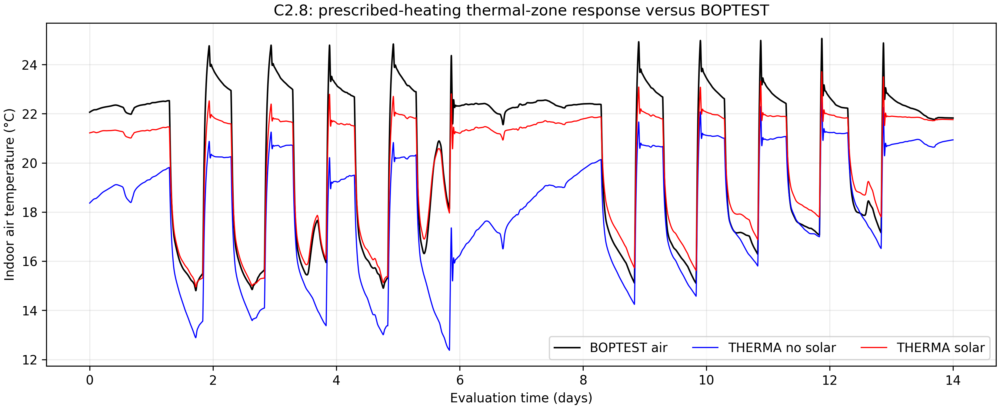
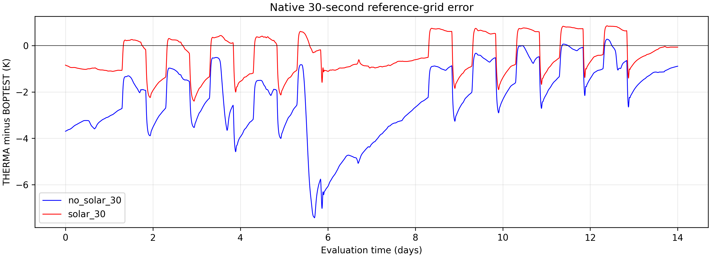
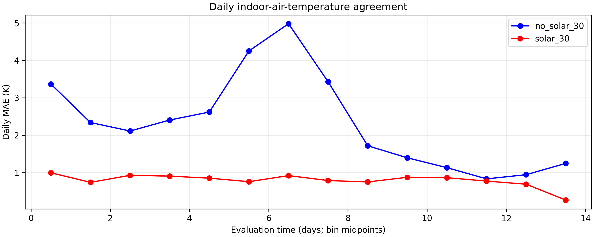

# C2.8 controlled BOPTEST air-temperature comparison

Actual supplied MATLAB R2024a outputs; Python post-processing. No MATLAB execution in cloud.
40,321 native 30 s reference timestamps; 14 evaluation days after 7-day warm-up.

| Metric (K) | No solar | Solar | Solar minus no solar |
|---|---:|---:|---:|
| MAE_K | 2.340532264 | 0.792534195 | -1.547998069 |
| RMSE_K | 2.805500413 | 0.923975534 | -1.881524879 |
| maximum_absolute_error_K | 7.434104854 | 2.397154533 | -5.036950320 |
| bias_K | -2.335196393 | -0.450613280 | +1.884583113 |

A negative MAE/RMSE change means improvement; assess bias by magnitude, not sign alone.

## Largest sampled deviations

- no_solar_30: -7.434105 K at evaluation day 5.693403.
- solar_30: -2.397155 K at evaluation day 2.939931.

## Interpretation and next step

These measurements evaluate reduced-zone response under prescribed BOPTEST radiator heat. They do not establish independent hydronic or real-world validation.
Supplied release metadata, solver, parameter and driver identities agree. Reference source equivalence was verified before comparing intervention scenarios.
Possible causes of remaining differences include reduced initial states, omitted window/airflow physics and solar allocation. These are hypotheses, not identified causes.
Review daily errors alongside all four C2.7 solver-step runs and original event-energy logs before selecting further physics changes. No recalibration or C2.9 implementation was performed.

Unsupplied energy_events.csv, solver_metadata.json and generated SLX files were not rehashed; completion claims for refinements are not independently checked. Full convergence/energy certification is outside this supplied pair.
MATLAB PNG/FIG reproduction remains pending university execution; Python generated the actual PNG/PDF figures and metrics here.

## Execution-lineage qualification

The uploaded solar CSV is byte-identical to preserved C2.6C solar evidence, whose earlier report recorded R2021a. The new supplied contract/report state R2024a. Numerical metrics are reproducible, but this payload does not establish a fresh independent same-release execution. Retain original university logs, solver metadata and event files for lineage review before making that claim.

## Measured changes and figures

Solar reduces MAE by **66.1387%**, RMSE by **67.0656%**, maximum absolute error by
**67.7546%**, and bias magnitude by **80.7034%**. All 14 daily MAEs improve for the
supplied trajectories. The maximum solar/no-solar temperature difference on the
reference grid is **7.153831909 K**, consistent with the user-reported approximately
7.154 °C. This measures trajectory separation, not accuracy by itself.

## Alignment and provenance

Both supplied receipts and all six consumed export hashes match the study index
and contract. The no-solar evaluation has 58,008 samples; solar has 59,292 samples.
Both have strictly increasing finite timestamps, exact evaluation endpoints and
maximum adjacent gaps of 30 seconds. Their continuous air temperatures are
linearly interpolated without extrapolation onto the 40,321 native BOPTEST samples.
No warm-up samples, operative temperature, replay input temperatures or adaptive
sampling-density weights are used in accuracy metrics.

Pinned BOPTEST a29024f8c453517ccbd1186006a3fa6af8de1ae2 and IDEAS
f1fdd8b22d39dc50297c47b6433e44381e40d0ff. The source is the original pinned
unchanged FMU run, recovered locally without simulation. All 61 original channels
in the later solar extraction match numerically over the full 21 days, despite
its distinct whole-file hash. See [reference guide](C28_REFERENCE_VALIDATION.md)
and [analysis provenance](results/c28/provenance.json).

Raw uploads remain byte-preserved under ignored outputs/. No previous C2.6C
result was changed. The supplied index records four completions; only the two
attached cases were inspected. No separate MATLAB test log was supplied here.

## Recommended next milestone

Close the evidence review: obtain original university solver_metadata.json and
study/test logs explaining the solar CSV's identity with earlier R2021a evidence,
then inspect solar_15/solar_5 plus event logs for convergence and integrated energy
closure. Reproduce the comparison in MATLAB if FIG artifacts are required. Only
then choose a targeted physical discrepancy study. No new physics or C2.9 work is
justified solely by successful execution or the remaining cold bias.
