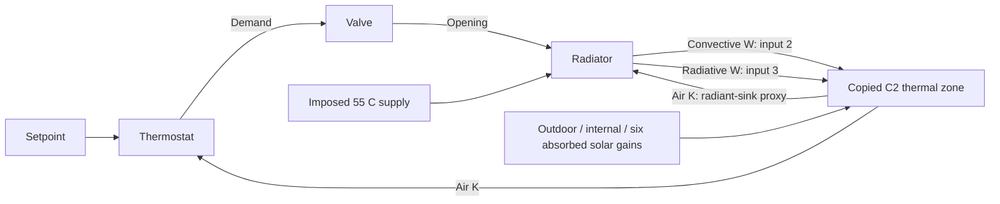

# C3.4 closed-loop thermal-zone integration

Status: **implementation and offline verification workflow prepared; MATLAB
integration execution pending**. No C3.4 trajectory, figure or successful numerical
result was generated in cloud. C3.5/C3.6 and C4 have not started.

## Component gate reviewed from actual attachments

The supplied report confirms **13 passed, 0 failed, 0 incomplete**, duration
**34.1251171 s**, MATLAB **25.1.0.2943329 (R2025a)** / Simulink **25.1 (R2025a)**.
This differs from the requested R2024a target and is recorded without relabeling.
All nine component/test/runner source hashes and the assumptions hash match the
unchanged repository sources; the package-provenance hash matches the original
C3 ZIP. The report and short log do not contain raw maximum-error/residual values.
Passing the tests confirms their assertions, not invented measured diagnostics.

The original report is preserved unchanged under ignored
outputs/c3/evidence/82f4706b453a256c/. Its SHA-256 is
`82f4706b453a256c4cbd47f8869b1e2026701ee75537b9ed899c711288cce86a`.
The exact test log and public, path-free selected summary are archived under
verification/c3/component_gate/. The original JSON includes personal network paths
and is not copied into a public package. The three SLX model files were not
supplied, so their reported hashes cannot be independently checked. Codex did not
execute those tests. This evidence passes the component implementation gate and
permits preparation of C3.4, not a C3.4 verification claim.

## Architecture and preservation

`build_c34_model` calls the existing C2 generator into a new output folder, copies
its graph into a new Thermal_zone subsystem, and closes that freshly generated
source without saving changes. It checks that the generated source SLX hash stays
unchanged. Existing user models must be closed explicitly; none is overwritten.
The original C2 builder, loaders, layer physics and C3 component builders are
unchanged. Model Workspace Z is copied by value; only initial temperatures change
in the new variant. Geometry, materials, conductances, capacities, solar/internal
routing and all envelope equations remain original C2 values.

C2's input vector remains:
`[Tout, Qconv, Qrad, Qinternal_conv, Qinternal_rad, Qsolar(1:6)]`.
Only elements 2 and 3 now come from independent C3 radiator outputs. There is no
prescribed BOPTEST radiator channel, replay file or reference heating added to
those outputs. The thermostat and radiator both use the actual C2 air temperature.
The thermostat/valve/radiator source files are reused unchanged and are checked
against the actual component gate at runtime.

Feedback includes the existing air/radiator integrators and controller state; no
arbitrary stabilizing delay is added. Algebraic loops and nonfinite signals are
configured as solver errors. This is a thermal emitter/control loop with imposed
flow mapping and supply temperature, not a solved pump/pressure/boiler system.
Water heat must not be described as fuel/electric energy consumption.

## Explicit initial integration fixture

All boundaries and numerical settings are in configs/c3/integration_c34.json,
classified illustrative, not calibrated or a BOPTEST benchmark:

| Quantity | Setting |
|---|---:|
| Initial air | 15 °C (user request) |
| Initial fabric nodes | 15 °C (explicit added assumption) |
| Initial radiator | 15 °C (explicit equilibrium assumption) |
| Setpoint / full deadband | 21 °C / 1 K |
| Imposed supply | 55 °C |
| Outdoor | Held 5 °C, illustrative |
| Internal convective/radiative gains | 0 / 0 W |
| Six absorbed solar powers | All 0 W, explicitly retained input paths |
| Heating enable / initial valve | Enabled / 0 |
| Observation interval | 86400 s (24 hours), illustrative |
| New integration solver | ode15s, RelTol 1e-8, AbsTol 1e-10, max step 10 s |

The radiator's default initial temperature is overridden **only in this copied
integration fixture**. Its capacitance, UA, flow map and dynamics stay unchanged.
C2 material reference temperatures are not edited: energy diagnostics subtract
actual initial stored energy, so reference offsets do not create phantom heat.
These are new model settings; frozen C2 solver/settings are not modified. No
setpoint attainment, sizing adequacy, convergence or comfort result is assumed.

## Radiative sink review

The verified radiator computes Qrad = f*UA*(Tradiator−Tair). This preserves its
explicit air-as-radiant-sink approximation; it is not exact mean radiant or
operative temperature. C2 distributes that signed radiant heat by its unchanged
opaque-area weights. The model logs opaque-mean temperature alongside air/radiator
for inspection but does not substitute it into the verified component silently.

Global energy cancels consistently, yet the air-proxy constitutive law is not a
reciprocal radiator-to-each-surface exchange and may distort local exchange or
passivity. Passing energy closure cannot establish radiative-physics accuracy or a
formal maximum principle for the combined approximation. Reviewing this boundary
is a future physical-model decision, not a calibration performed in this task.

## Energy accounting and numerical diagnostics

Radiator: dUr/dt = Qwater−Qdelivered.
Zone: dUz/dt = Qenvironment+Qdelivered.
Combined: d(Uz+Ur)/dt = Qenvironment+Qwater.

`Qenvironment` sums the original C2 exterior, ventilation, window, internal and
solar terms; it **excludes radiator delivery**. A new native continuous integrator
accumulates combined external energy. The original radiator energy integrators
track water/room transfers. Integrated residuals use initial-offset storage:

- Radiator: Ewater−Edelivered−DeltaUr.
- Combined: Eexternal−DeltaUz−DeltaUr.

No sparse exported-log quadrature is used as the primary energy test. Original
nondecreasing event order and duplicate timestamps are preserved in logs/CSV.
Instantaneous balances are also checked, but are algebraic diagnostics and cannot
alone prove conservation. Heating-port equality and convective+radiative partition
are checked to detect missing/doubled coupling.

The runner checks finite positive temperatures, every C2 temperature state,
binary sampled demand, switching on controller instants, opening/flow bounds,
and energy consistency. With zero environmental gains it also screens observed
temperatures against the imposed initial/boundary envelope and derives conservative
power bounds from that envelope, UA and flow/cp. These are **provisional screening
checks**, not a formal passivity proof, catalogue power limits or physical accuracy
criteria. Nonzero-gain cases do not use the zero-gain upper-envelope screen.

Provisional thresholds are explicit in configuration: instantaneous residuals
1e-5 W; energy budget 1 J + 1e-6 times maximum absolute logged energy/storage-change
magnitude (at least 1 J); temperature envelope margin 0.001 K. No threshold was
selected from a measured integration result; none has yet been observed here.
Failures remain failures with actual diagnostics, not automatic tuning/clamping.

## Executable integration gate and outputs

`run_c34_verification()` verifies the standalone package and prior component source
identity, reruns the existing 13 component tests, and adds four integration/CSV
tests: cold-start feedback/initial state/energy checks; scheduled disable and valve
closure; disabled heating with stored radiator release and zero water input; and
17-digit CSV precision/duplicate event preservation. These are C3.4 software and
integration fixtures, not implementation of the six C3.5 engineering experiments.
A sampled disable may take up to one controller period; residual actuator flow
and stored heat must be distinguished during closure.

Only after tests pass does the runner execute the requested nominal cold start.
It produces actual CSV (locally staged/chunked at %.17g and copied with SHA check),
PNG/FIG trace and energy plots, a measured engineering report and a structured
verification report. The CSV preserves all original event rows and includes units
in column names. Output directories are unique; failed/partial runs are not marked
completed, and earlier results are never overwritten. Recursive MATLAB exception
causes and actual test console text are retained. No prebuilt integration SLX is
claimed; the runner saves the editable native model on the university computer.

## Evidence limits and next step

Available cloud checks cover Python/software contracts, immutable source/evidence
hashes, MATLAB static syntax and standalone package structure. **MATLAB/Simulink
C3.4 execution is unavailable in cloud**, so no integration result, numerical
residual, successful simulation or generated figure is claimed. R2024a is the
intended API target, not an executed compatibility result. The new runner records
the actual release separately from the incoming R2025a component evidence.

Run [START_C34.md](../START_C34.md) on university MATLAB. Review actual diagnostics
and returned traces before C3.5/C3.6. Existing C2.8 MAE and unresolved solar-payload
lineage remain unchanged and cannot be reused as C3 accuracy evidence. C4 remains
gated. No calibration or unrelated physics has been introduced.
