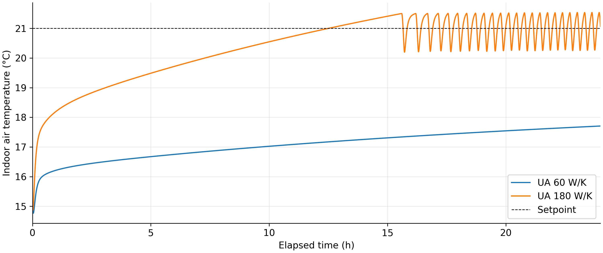
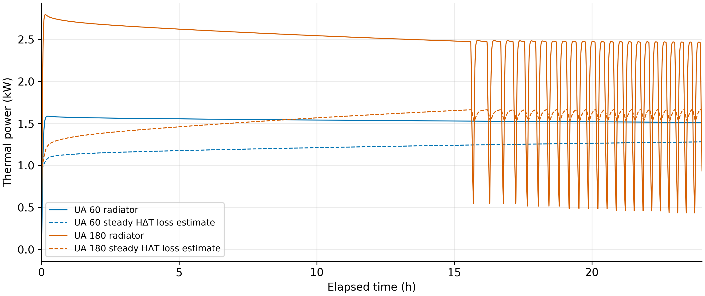

# C3.6 — Building and radiator reality check

**The supplied C3.5 MATLAB R2025a results confirm 12.508 h to 21 °C with UA 180.**
Both original case reports and CSVs match their completion-receipt SHA-256 hashes.
Post-processing here used the actual uploaded results; MATLAB was not executed here.
The 16 passed C3.5 tests remain user-reported (no test log supplied).

## 1. What building is this?

A **single heavy BESTEST test zone**, not a whole house or the 36-room thesis:

| Specification | Existing value |
|---|---:|
| Dimensions / floor area | 8 × 6 × 2.7 m / **48 m²** |
| Indoor volume | **129.6 m³** |
| Opaque external walls / roof | 63.6 / 48 m² |
| South windows | 12 m²; static U = 3 W/(m² K), UA = 36 W/K |
| Wall layers, outside → inside | 9 mm wood siding; 61.5 mm foam; 100 mm concrete block |
| Wall material resistance / current film-only U estimate | 1.798 m² K/W / 0.455 W/(m² K) |
| Roof layers | 19 mm deck; 111.8 mm fiberglass; 10 mm plasterboard |
| Roof material resistance / current film-only U estimate | 2.993 m² K/W / 0.295 W/(m² K) |
| Floor | 48 m², 80 mm concrete plus benchmark insulation; **adiabatic exterior** |
| Infiltration | 0.018 m³/s = 0.5 air changes/hour |

Using the current assumed surface films (inside 3, outside 15 W/(m² K)), opaque
loss is approximately 43.08 W/K, windows 36, infiltration 21.73: **H ≈ 100.81 W/K**.
The exact reduced-network response with the existing 65% convective/35% radiative
heat split gives an emitter-to-air equivalent **105.34 W/K**, so maintaining
21 °C at 5 °C outdoors requires **about 1.69 kW**. The difference comes from the
surface/radiant gain routing; neither coefficient is a measured house rating.
The floor stores heat but adds no outdoor loss in this model.

Sources: [frozen registry](../configs/references/boptest_bestest_hydronic.json),
[C2 assumptions](../configs/references/c2_reduced_assumptions.json), existing
parameter loaders and `c35_steady_diagnostics`. Numbers above are static algebra,
independently checked by eliminating the existing steady surface network; no
thermal simulation or new model was introduced. The film-only U estimates are
not the reference library's design U-values or a DIN EN 12831 calculation.

## 2. Is the radiator large enough?

At full opening, flow = 0.03 kg/s (108 kg/h), water cp = 4180 J/(kg K), supply
55 °C and air 21 °C. The existing mixed-radiator equations give
`Q = (Hwater*UA)/(Hwater+UA)*(55−21)`, where `Hwater = 125.4 W/K`.

| Radiator UA | Available heat | Margin against 1.685 kW demand | Mixed return | Conditional all-on steady air |
|---|---:|---:|---:|---:|
| 60 W/K | **1.380 kW** | **−0.306 kW** | 44.0 °C | 18.91 °C |
| 180 W/K | **2.513 kW** | **+0.827 kW** | 35.0 °C | 25.62 °C |

Thus UA 60 cannot **maintain** 21 °C under these conditions, even after fabric
warm-up. UA 180 has steady heating headroom; the thermostat should limit it rather
than run continuously toward 25.62 °C. Those steady temperatures are conditional
all-on calculations, not new simulated trajectories. Flow limitation means tripling
UA does not triple available power. The values are plausible power magnitudes,
but these UA values are **illustrative linear coefficients, not commercial ratings**.
The 3 kg water / 20 kg metal inventory stays unchanged during the UA sweep, which
is useful sensitivity analysis but not a realistic product-resizing rule. A real
radiator type, dimensions and manufacturer rating remain unknown.

## 3. Why roughly 12.5 hours?

The fabric stores **15.485 MJ/K**: walls 9.232, roof 0.872, floor 5.381. Air adds
only **0.156 MJ/K**. Raising every modeled node by 6 K would store **26.07 kWh**;
heating only the air needs **0.261 kWh**. This illustrates scale, not actual energy
to the first air-temperature crossing: fabric temperatures are nonuniform.

All air, fabric and radiator start at 15 °C—a deep cold soak, not normal reheating
while walls remain warm. Heavy concrete absorbs much of the heat, while losses
continuously reduce the power available for warming. Near 21 °C, the larger
radiator has only about 0.83 kW above steady demand. A many-hour warm-up is therefore
**physically plausible within this model**. The baseline has a separate steady
capacity deficit; inertia alone does not explain its inability to maintain 21 °C.

The supplied trajectories show:

| Case | First 21 °C | Final air at 24 h | Delivered heat¹ | Outgoing loss¹ | Building storage¹ |
|---|---:|---:|---:|---:|---:|
| UA 60 | Not reached | 17.707 °C | 36.866 kWh | 31.999 kWh | 4.867 kWh |
| UA 180 | **12.5077 h** | 21.069 °C | 32.582 kWh | 20.122 kWh | 12.460 kWh |

¹ Budget at 24 h for UA 60; at the first logged sample reaching 21 °C
(12.5083 h) for UA 180. First-crossing time uses the existing piecewise-linear
metric definition. These are different checkpoints, not a same-duration energy-efficiency comparison.

For UA 180, **61.8%** of delivered heat escapes and **38.2%** remains as net
building storage by first reaching 21 °C. Average delivered power is about
2.605 kW, average outgoing loss 1.609 kW, and net building charging only 0.996 kW.
So losses consume the larger energy share; heavy thermal mass creates the slow
response. Neither is negligible. The existing all-on linear diagnostic has a
slowest time constant of **27.31 h** (UA 180), consistent with slow fabric warming;
it is not an independent warm-up prediction for the thermostat-controlled system.
The full-open radiator's own fixed-room time constant is only about **74 seconds**
(UA 60: 122 seconds), so radiator storage alone cannot explain 12.5 hours.
The valve also responds on a minute scale. No extra simulation was needed.

Native cumulative states close `water input = outgoing loss + building storage +
radiator storage` throughout both records: maximum absolute discrepancy below
**0.00012 J** against original allowed budgets of 134/206 J. UA 180 radiator
storage at the checkpoint is 0.125 kWh. This establishes numerical accounting,
not field or benchmark validation. There are no absorbed solar gains in either case.

The dashed loss curves use **100.81 × (indoor−outdoor)** W, a steady estimate.
They are not the instantaneous loss from initially warm external construction
surfaces. Actual loss energies above come from native exterior/window/ventilation
integrators, not sparse-CSV quadrature or the dashed estimate.

Provenance: [metrics and input hashes](results/c36/physical_check.json),
[unchanged small original reports and receipts](../verification/c3/c36/).
The CSVs contain 17,667 / 26,271 finite, ordered samples, all 34 expected columns,
and complete 0–86,400 s coverage. Both receipts reference the same study-contract
digest. The original study index/contract and other receipt-listed artifacts were
not uploaded; their contents are not independently verified here. Large original
CSVs remain unchanged in local upload storage and on the university PC; they are
not added to Git. The MATLAB entry point checks the full existing study contract
on that PC, reads the two completed cases, and creates only these two plots.

## 4. Limits and C3.7 recommendation

This is a deliberately heavy benchmark cell, with an adiabatic floor and unusual
benchmark floor-insulation properties, not evidence of a specific real house.
Constant films, static window UA, imposed flow/supply and an air-based radiant sink
remain approximations. No BOPTEST, field or standards compliance is established.

For C3.7, first agree on the intended building/construction and initial fabric
temperature, then check a manufacturer radiator rating at the intended water/room
temperatures. Do not tune this benchmark to force a shorter warm-up or add nonlinear
models yet. **C3.7 has not started.**

MATLAB: extract the small C3.6 update into the existing THERMA_C35_MATLAB folder,
then run `run_c36_physical_check`. If more than one distinct study pair exists,
pass the intended `study_capacity.json` path. Existing results remain read-only.
