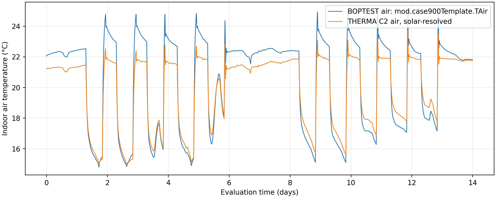
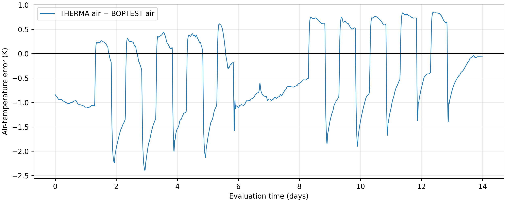

# C3.9 — Existing BESTEST thermal-zone comparison

**Actual preserved-result post-processing complete; no simulations rerun.**
The previously reported solar MAE is confirmed: **0.792534195°C**, not an assumed
value. Python reused the existing C2.8 receipt, semantic, alignment and metric
checks. MATLAB R2025a reproduction is prepared but unexecuted here.

## Reference and matching conditions

Single heavy BESTEST900-derived **48m²/129.6m³** zone, not the20m² C3 residential
room. Pinned BOPTEST `a29024f8c453517ccbd1186006a3fa6af8de1ae2`, IDEAS
`f1fdd8b22d39dc50297c47b6433e44381e40d0ff`; unchanged FMU SHA256
`365b3085d97cc4620c06b6036156126a056d7f160fcc4f181d6b2fac4b05743b`.
Active weather is **Brussels.mos**, as recorded by the preserved FMU run, not an
assumed Denver weather file. Native reference weather/heat/internal gains are
reused: outdoor temperature linearly interpolated, powers held from30s samples.

Initialization day327(28,252,800s), seven-day warm-up, evaluation days334–348
(**28,857,600–30,067,200s**,14days), with no evaluation-start reset. Declared start
293.15K matches initialized reference air/selected temperatures; this is not a
complete portable FMU restart. Original moisture/glazing and all hidden states
are not reproduced by the reduced28-state C2 model.

Prescribed radiator heat is **−(mod.rad.QCon_flow+mod.rad.QRad_flow)** into the
zone, not gas input or boiler output. Internal sensible convective/radiative
source ports and six source-derived absorbed opaque solar powers are retained.
The separate glazing solar share is not silently redistributed. The reference
controller's behavior is embedded in the prescribed heat; **C3's independent
thermostat/radiator are not connected**. No parameter is recalibrated.

## Air temperature and delivered heat

Compare THERMA `air_temperature` with **`mod.case900Template.TAir`** (equivalently
`mod_case900Template_TAir` in sanitized exports). **`reaTRoo_y` is operative
temperature and is excluded**. Original unitsK, displayed°C. Both series use the
same40,321 native30s reference timestamps. Adaptive THERMA temperatures are
linearly interpolated without extrapolation; warm-up is excluded. Original
reference air values were checked directly against the hash-verified source CSV.

| Metric | Solar-resolved THERMA C2 versus BOPTEST air |
|---|---:|
|MAE|**0.792534195K**|
|RMSE|**0.923975534K**|
|Maximum absolute sampled error|2.397154533K|
|Bias, THERMA−BOPTEST|−0.450613280K|

These reproduce the preserved C2.8 values exactly. They describe this trajectory,
not an accuracy guarantee for other scenarios or a real-world validation.

| Signed heating-energy reconstruction, same14days | kWh |
|---|---:|
|Reference native30s previous-hold heat|529.386194|
|THERMA adaptive-log previous-hold heat|529.450119|
|Reference forcing sampled on that same adaptive log grid|529.450119|

Each logged convective/radiative input matches source previous-hold values within
**5.01×10⁻¹²W**. The two grid energy estimates differ0.063925kWh(0.0121%): this is
sampling/reconstruction sensitivity, not measured equipment losses or savings.
No continuous FMU heat-integral or native event-integrator proof is supplied here.
All392 negative reference total-power samples are retained, with no clamping.
This is **prescribed-input consistency**, not independent heating-system validation.





## Discrepancies, limitations and next step

Evidence: the reduced model has static window UA, dry-air storage, fixed inside/
outside film coefficients3/15W/(m²K), and pairwise surface radiation4W/(m²K).
Its opaque solar distribution omits the separate glazing share and it does not
restart the full FMU state. These approximations can affect temperature response;
**their individual contributions to the remaining error have not been measured**.
A cold mean bias alone does not identify a cause.

Retain the existing execution-lineage qualification: this solar CSV is byte-identical
to earlier C2.6C evidence reported R2021a, while the supplied C2.7 metadata says
R2024a. The numerical comparison is reproducible, but a fresh independent R2024a
run and full convergence/event-energy certification are not established. No original
C2.8, C3.7 or C3.8 result is modified. Provenance/hashes are in
[metrics.json](results/c39/metrics.json).

Next: obtain the original university execution/solver/event records to resolve
lineage and numerical convergence before assigning physical causes or choosing a
new refinement. No new physics or C4.0 work is started.

## Reproduction

Extract the minimal C3.9 update into the existing `THERMA_C35_MATLAB` folder.
It includes compact, verified **derived** temperature/heating tables, not fabricated
or rerun data. No old C2.7/C2.8 project folder, FMU, Git, Python or Internet is
needed on the PC. In MATLAB R2025a:

```matlab
results = runtests(fullfile('tests','matlab','test_therma_c39.m'));
assertSuccess(results);
folder = run_c39_boptest_comparison;
```

The two small MATLAB SOFTWARE tests and entry point remain unexecuted in cloud.
The entry point only reproduces the two PNGs and numerical metrics; it never
simulates a model. Development reproduction from the preserved original artifacts:

```bash
uv run --offline --frozen --with matplotlib==3.10.8 python scripts/boptest/prepare_c39.py \
  --study outputs/boptest/c27/tp699bca3b_8a25_4758_bc2c_6cf11011e6b7/study_index.json \
  --reference outputs/boptest/c28/reference_verified \
  --run outputs/boptest/runs/typical_heat_day_ailcox5y \
  --output outputs/boptest/c39/comparison_new
```
