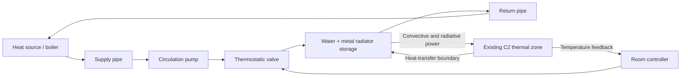

# C3 hydronic architecture — design only

No C3 component is implemented. Start only after actual C2.7 same-release control,
step refinement, input integrity and energy diagnostics have been reviewed. The
36-room thesis network remains a separate preserved reference; begin with one
radiator/zone, not an immediate whole-building reconstruction.

## Coupling boundary and modular architecture

Keep the verified envelope/zone and its outdoor/internal/solar ports unchanged.
Replace only the prescribed convective/radiative radiator powers with outputs from
an independently verified emitter. Feed zone air and relevant radiative-temperature
information back to the emitter; the current opaque mean temperature is a proxy,
not the exact reference mean radiant temperature. Declare the selected boundary.

The drawing is logical; actual pump placement and expansion/pressure-reference
connection must follow the chosen hydraulic topology, not this page's layout.

Component interfaces should declare units/signs: fluid mass flow kg/s, pressure Pa,
temperature K, specific enthalpy J/kg, power W, actuator opening dimensionless and
controller sampling time s. Positive flow follows supply-to-return orientation;
reverse flow/heat must be handled or explicitly excluded by an evidenced component
contract, never silently clamped to make a benchmark fit.

## Required components and parameters

| Component | Required behavior / verification |
|---|---|
| Boiler/hot-water source | Heat-input limit, temperature/control dynamics, storage and losses; distinguish input fuel from delivered fluid heat |
| Pump | Pressure-rise/flow characteristic, operating limits and hydraulic/electrical power; avoid imposing incompatible head and flow simultaneously |
| Supply/return pipes | Pressure losses plus optional fluid/pipe thermal storage and ambient heat exchange, introduced in stages |
| Flow solver | Mass conservation at nodes and pressure closure around the loop, with a pressure reference and valid fluid properties |
| Radiator | Fluid and metal energy storage, heat-transfer law and separate convective/radiative delivery |
| Valve | Opening-to-resistance/Cv relation, saturation/leakage and any physical dynamics; documented behavior at zero flow |
| Controller | Initial state, deadband/PI logic as selected from the reference, anti-windup and sampling/event policy |

Use only verified BOPTEST extraction or explicitly supplied thesis/design data for
initial parameters. Missing pump curves, valve coefficients, boiler capacities,
pipe dimensions and emitter details remain unresolved until sourced. Do not invent
nominal powers, water temperatures or material properties. No DIN EN 12831 or real-
world compliance/accuracy claim follows from BESTEST agreement.

## Approach A — Simscape Fluids / Thermal physical network

Represent water transport in the release-appropriate single-phase thermal-liquid
network; use physical thermal connections for radiator/pipe storage and exchange.
Provide solver configuration, fluid properties and a consistent pressure reference.
Signal conversion blocks connect controller signals and C2 power/temperature ports.
Never connect incompatible physical domains directly or duplicate heat/storage on
both sides of an interface.

Dependencies: MATLAB, Simulink, Simscape, and Simscape Fluids for the proposed pump/
valve/network implementation. Basic thermal components may be in Simscape; advanced
fluid components require the corresponding Fluids installation/licence. An initial
ideal pump does not require an electrical motor model/Simscape Electrical.

Advantages: coupled mass/energy balances, reusable physical connections, reverse-flow
handling and component libraries. Costs: nonlinear/stiff DAEs, initialization and
pressure-reference constraints, extra licences and potentially larger simulations.
Check exact available R2021a block names/options on the university installation;
do not build against blocks introduced only in newer releases. Local solver and
state initialization choices need independent convergence tests, not assumptions.

## Approach B — Equation-based Simulink subsystems

Use ordinary Simulink integrators, gains and explicit component equations with
standard MATLAB/Simulink only. Begin with sourced prescribed mass flow and an
emitter energy balance, then add the hydraulic pressure/flow closure as a separate
verified subsystem. This is an incremental verification boundary, not a claim that
prescribed flow is a complete hydraulic model.

For an emitter, the signed balance has the form
`m_dot*(h_in-h_out) = dU_fluid/dt + dU_metal/dt + Q_conv + Q_rad + Q_other_loss`.
Choose a physically justified discretization/constitutive law from the reference
before implementation; the expression is a conservation constraint, not a fitted
radiator law. Pump/valve flow equations may form algebraic loops and require a
well-posed pressure solve. Do not add arbitrary delays to conceal an algebraic loop
or force a desired solver result.

Advantages: transparent equations/interfaces, low toolbox burden, easy component
analytic tests and R2021a-compatible blocks. Costs: all mass/energy bookkeeping,
fluid properties, flow reversal, pressure solving and initialization are project
responsibilities; a signal diagram alone does not guarantee physical conservation.

## Recommended staged hybrid

1. Preserve C2 as an equation-based thermal zone. Define shared signed interfaces
   and reference observables before selecting a fluid backend.
2. Verify an isolated water/metal emitter with sourced parameters and prescribed
   flow, including adiabatic/zero-flow/steady-state tests.
3. Add valve and controller to one zone; verify saturation, steady-state and energy
   transfers before adding a pump/network solve.
4. Evaluate a Simscape Fluids loop if R2021a licences/resources permit; otherwise
   implement and test the equivalent pressure/flow equations explicitly. Maintain
   separate backends with the same component contracts rather than mixed duplicate
   hydraulic loops. Record exactly which losses/storage are active.
5. Add source/pipe dynamics, then compare full loop transients against the pinned
   reference. Only then consider modular multi-room topology and the thesis model.

## Verification before claiming progress

Software tests cover dimensions, units, topology, parameter provenance and errors.
Physics verification covers node mass balance, source/emitter/zone energy closure,
known steady/adiabatic transients, zero-flow limits and initial-state consistency.
Numerical tests vary solver/tolerances/step with explicit event treatment and quantify
runtime. Benchmarking compares independently generated reference trajectories with
matching controls/weather/states. Actual field validation requires real measurements
and an uncertainty/acceptance plan; neither option supplies that automatically.

Do not calibrate heat-transfer coefficients to hide missing glazing or exterior
forcing. C3 acceptance thresholds and reference scenarios must be specified from
engineering requirements and measured numerical sensitivity, not invented here.
