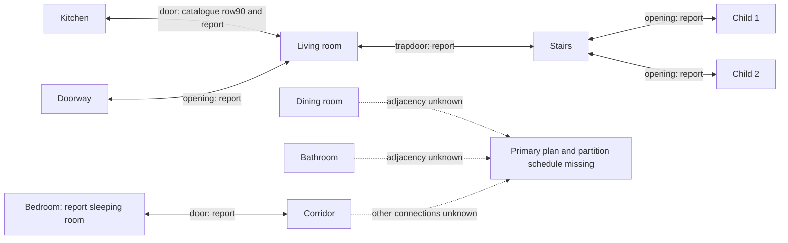

# C4.1 — Candidate N2 thermal spaces and documented openings

This is a **proposed zoning/data inventory**, not an implemented thermal network
or a complete reconstructed floor plan. Names come from the measurement catalogue;
the secondary KU Leuven report describes10 model zones, but the final mapping and
zone count await primary plans. Solid edges below are reported door/trapdoor
connections, **not known wall areas/conductances or measured airflows**.

The six solid opening connections are specifically listed in
[Report_v2.pdf §2.8.5,p17](https://github.com/gmor/annex71_st2_common_exercices/blob/ae7614bed0d7e5f5e73b3d52e6bcec8efe5f85f9/docu/Report_v2.pdf).
The kitchen–living connection is independently named in
[Measurement Channel List.xlsx,row90](https://github.com/gmor/annex71_st2_common_exercices/blob/ae7614bed0d7e5f5e73b3d52e6bcec8efe5f85f9/docu/Measurement%20Channel%20List.xlsx).
The report states doorway–living and both child–stairs openings are always open;
other door schedules vary by phase. Those are **author-reported** conditions,
not independently checked primary schedules. Its ventilation-routing assumptions
are not promoted to additional physical adjacencies.

Dashed arrows point to missing information, not heat-flow paths. Connections not
shown remain unknown; absence is not an adiabatic-boundary assumption. In particular,
do not infer dining/bath connections merely because rooms share a ventilation circuit.

Future boundaries: exterior walls/windows/roof map to measured outdoor temperature
and radiation only after orientation/area/blind verification. Ground-floor boundary
is measured cellar temperature in the report (§2.4.3); the floor between ground
and attic is interzonal (§2.4.4). Full exterior/partition/window mapping and materials
remain blocked on `Plans_TwinHouses.pdf` and `01_Constructions_TwinHouses.xlsx`.
No shared-wall dimensions, U-values or new heat-transfer equations are assigned.
