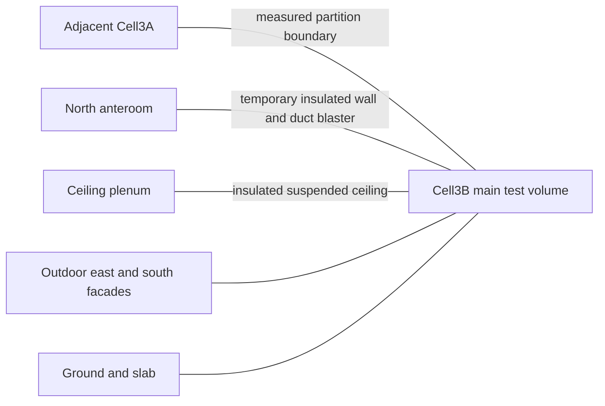

# C4.2B — Documented FLEXLAB building specifications

Source throughout: pinned official report **Measured dataset for validation of
building energy modeling programs.pdf**, April2023; source commit/hash/URLs in
[source audit](results/c42b/source_audit.json). **No executable building model is
created.** “Specified” means documented by authors, not independently measured here.

## Geometry and boundaries

| Parameter | Documented value / classification | Exact report source |
|---|---|---|
| Site | Berkeley, California;37.879125,−122.253856; altitude232m; specified | §3.1,p2 |
| Thermal arrangement | Cell3B main test zone, north anteroom and ceiling plenum: three zones; specified | pp2–3 |
| Recommended validation volume | Only main Cell3B; adjacent rooms/plenum may be represented by measured boundary temperatures; specified | p3; AppendixB introduction,pB-1 |
| Main internal width |6.08m; specified | FigsB-1,B-4,B-5,B-6,ppB-1–B-3 |
| Main internal depth |7.57m; specified | FigsB-2,B-3,B-5,B-6,ppB-1–B-3 |
| Main clear height |2.63m; specified | FigsB-1–B-4,ppB-1–B-2 |
| Rectangular floor area |46.0256m²; **calculated**6.08×7.57, not a surveyed value | Derived from above |
| Rectangular air volume |121.047328m³; **calculated**area×2.63, not net of contents | Derived from above |
| Approximate prose dimensions | Main area46.4m²; depth7.59m; suspended ceiling2.74m; approximate/specification conflict | p2; p3 explicitly says use updated AppendixB dimensions |
| South glazed wall |5.88×1.86m; ten windows; specified. Published summed areas10.949m² and UA3.836W/K are retained rather than recomputed from rounded dimensions | TableA-1,ppA-9–A-10 |
| Temporary north door |0.75×2.11m; specified; position offset5.09m | FigB-4,pB-2 |
| Orientation | Facades labelled south/east/west/north;3A on west; **numeric azimuth relative to true north not established in this audit** | pp2–3,AppendicesA/B/E |
| Ground reflectance |0.208; **measured** | p2 |

Do not copy the main-body approximate3D drawings into a model as exact geometry.
The building is a highly insulated experimental perimeter test cell, not a20m²
residential room or a full occupied home. No Annex58/Annex71/BESTEST geometry applies.

## Constructions and material data

Layer order in **Auxiliary Data/Construction.csv** is outside-to-inside. Corresponding
published tables are B-1(ppB-3–B-7),B-2(ppB-7–B-8),B-3(pB-9). AppendixC explains
2D/3D equivalent layers; they are derived representations, not homogeneous measured
materials. All material thickness/k/rho/cp entries below are **specified**; no assumed
properties have been introduced.

| Surface / actual construction key | Documented layers and qualification |
|---|---|
| Floor / Floor-SLAB_3 | HW concrete5in → horizontal insulation5in → topping slab6in → polyiso2in → polyiso2in → plywood0.5in; FigB-6,pB-3 selects this key. Other slab variants exist; do not silently replace it. |
| Ceiling / Ceiling-Const | Cotton batt7in → acoustic tile0.75in in detailed TableB-1/CSV. Table3-1,p4 instead describes radiant cooling tiles; **resolve this assembly/capacitance discrepancy before freezing a model**. No radiant-cooling operation inferred. |
| Roof / Roof-Const | Roof decking0.5in → R20 board4in → plywood1.125in → spray-on insulation/wood; above plenum, not a second exterior boundary directly on main-zone air. |
| Main east / ZoneB-E2Wall-Const | Metal panel → air gap → equivalent K1 middle layer → plywood → SIP → plywood → additional6in insulation → gypsum; corner/edge sections have separate keys. |
| Main south / ZoneB-S2Wall-Const | Cement board → air gap → R3.8 board → plywood → equivalent south-wall layer → gypsum; separate edge/window sections. |
| West partition | Several W1/W2 construction keys; separate adjacent3A surface boundary, not outdoor weather; details in TableB-1 and Construction.csv. |
| Temporary north / TempNwall-SouthFacing-CONST | Gypsum → two2.25in polyiso layers → gypsum. **CSV orders NorthFacing then SouthFacing; report TableB-1 shows SouthFacing twice for the south-facing construction.** Do not silently reconcile their different surface absorptances. Door is a separate construction. |
| Covered windows |6mm single glazing/thermally broken aluminium plus external foam; weightedU0.350W/(m²K),SHGC0.004, specified WINDOW-derived results, TableA-1. These are experimental covered-window values, not ordinary residential glazing. |

Representative materials below are transcribed from Materials.csv, with matching
TableB-2 references. SI units: thickness m,k W/(m·K),rho kg/m³,cp J/(kg·K).

| Material | Thickness | k | rho | cp |
|---|---:|---:|---:|---:|
| Topping Slab 6" | 0.1524 | 1.95 | 2087 | 900.0 |
| Slab Horizontal Insulation 5" | 0.127 | 0.035 | 265 | 1300.0 |
| HW Concrete 5" | 0.127 | 1.311 | 2240 | 836.8 |
| Metal Panel 0.0433 | 0.0011 | 62 | 7580 | 485.0 |
| SIP 7.25" | 0.1842 | 0.038 | 29 | 1210.0 |
| Acous Tile 3/4" | 0.0191 | 0.057 | 288 | 1331.0 |
| Polyiso 2" | 0.0508 | 0.022 | 31.65 | 1500.0 |
| Cotton Batt 7" | 0.178 | 0.059 | 1480 | 1307.0 |
| Plywood 1/2" | 0.0127 | 0.115 | 545 | 1213.0 |
| Gypsum Board 5/8" | 0.0159 | 0.16 | 801 | 837.0 |
| Gypsum Board 1/2" | 0.0127 | 0.16 | 801 | 837.0 |
| AdditionalInsulation 6" | 0.1524 | 0.023 | 40 | 1500.0 |
| Equiv Layer K1-Kwall Middle | 0.0762 | 0.0504 | 48.3 | 1228.0 |

**Quality flags, not corrections:** the Cotton Batt density1480kg/m³ is present
in both material CSV and TableB-2; it looks atypical but remains unchanged and needs
author clarification. Other provided equivalent-layer densities are effective
properties, not necessarily physical constituent densities. Air-gap resistances
are0.158 and0.156m²K/W (No mass.csv/TableB-3). Do not add invented rho/cp to air gaps.
The complete source material table, including all equivalent layers, is available
at its immutable URL in the manifest; this selection is not a complete model registry.

## Experimental systems and initial conditions

- Main AHU inactive; diffusers blocked/dampers shut (p23). This is **not zero
  ventilation**: TEC Duct Blaster maintains nominal5Pa pressurization, drawing from
  anteroom; measured flow/supply temperature are supplied (§3.2.6,p10;§3.5,pp17–19).
  No fixed ACH is assumed. Residual leakage remains an uncertainty, not an invented
  infiltration schedule.
- Two custom FCUs with Boyd6340G2-M9 heat exchangers, two active fans each;
  water-temperature probes at the control-volume boundary account for hoses inside
  Cell3B (§3.3,p11). Cooling rate is derived from water measurements. Fan electrical
  heat must not be added again if already included in aggregate internal electrical
  gain; resolve accounting before implementation.
- Conditioned experiment:22June00:00–27June00:00,2021; nominal20°C control;
  internal gain~345W, additional heaters from25June15:00 (~3400W total), four
  controller glitches (pp21–22). Actual CSVs end26June23:59, not27June00:00.
- Initial air and measured surface temperatures are available; complete through-wall
  thermal states are not. Preconditioning is explicitly recommended(p31).
- Window solar is strongly suppressed by external foam. Measured solar, sky IR,
  exterior temperatures and AppendixE shading remain relevant; do not infer zero
  solar absorption or add both measured surface-temperature and exterior weather
  boundary heat terms to the same surface.

Main blockers to a frozen reconstruction: ceiling/temporary-wall inconsistencies,
Cotton Batt property clarification, chosen surface subdivisions/orientation, initial
fabric conditioning and measurement/derived-load accounting. These do not erase
successful acquisition, but prevent claiming that a validated model already exists.
