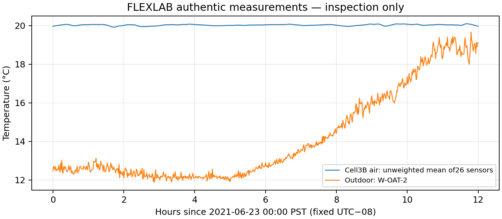
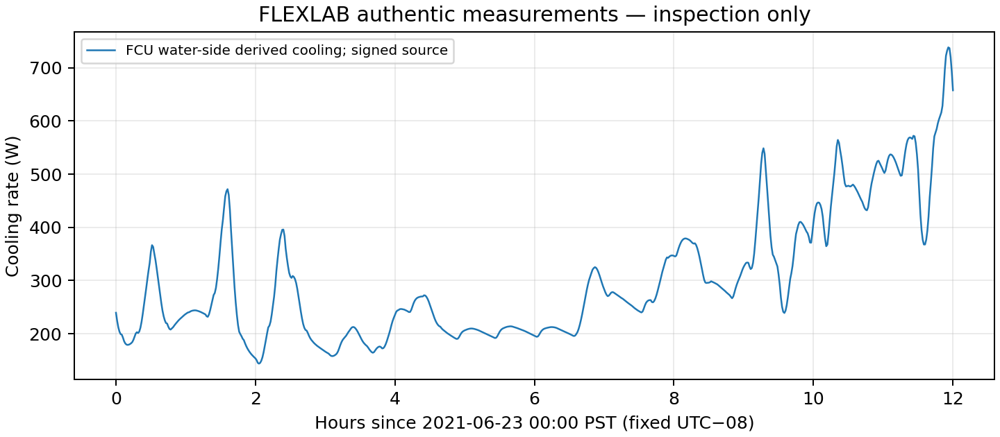

# C4.2B — FLEXLAB validation feasibility

**Recommendation: CONDITIONAL — retain as a separate Cell3B envelope benchmark.**
Actual primary experimental files were acquired, opened and mapped to documented
construction/boundary data. This closes the acquisition study; it does not close
native MATLAB execution, model reconstruction or empirical validation gates.
Do not replace THERMA's residential heating demonstration with this test facility.

| Requirement | Available | Source | Confidence |
|---|---|---|---|
| Geometry | Yes for main Cell3B; exact AppendixB preferred | ReportB-1–B-3,architectural PDFs | High for documented main volume; adjacent zones less completely audited |
| Construction materials | Yes, layered and equivalent definitions; conflicts flagged | Construction.csv,Materials.csv,IDF;reportB/C | Medium pending ceiling/north-wall/density clarification |
| Window properties | Yes, externally foam-covered experimental glazing | TableA-1,WINDOW IDF | High for published values; native WINDOW database not executed |
| Indoor temperatures |26 sensors,°C, genuine records | Air temperature.csv;metadata Direct Validation | High provenance; aggregation/stratification uncertainty remains |
| Outdoor temperatures | Weather-station and wall-local readings | Weather data.csv;Input worksheet | High for temperature; pressure unit conflict separate |
| Heating/cooling inputs | Aggregate electrical gains and water-side-derived FCU cooling | Internal heat gain rate.csv;Fan coil units.csv | Medium: signed cooling/heat accounting and uncertainties need explicit treatment |
| Solar radiation |GHI,DNI,DHI,PIRin | Weather data.csv;reportTable4-1 | High availability; absorbed gains/shading still must be modelled |
| Ventilation | Forced flow,supply temperature,derived heat transfer | Duct blaster.csv;pp17–19 | Medium: measured/derived, residual leakage uncertain |
| Initial conditions | Air/boundary observations; **complete fabric states absent** | Surface/air/ground CSVs;p31 | Partial; preconditioning required |

**A — Single-zone envelope validation: conditionally supported.** The authors
recommend Cell3B with measured surroundings; use their backward approach(p31):
prescribed measured cooling/gains/ventilation, predict **air** temperature and
compare against an explicitly defined sensor aggregate. There is no temperature
prediction or MAE/RMSE result yet. Resolve construction choices, initial conditioning,
signed load conventions and uncertainty treatment first. Ventilation power derived
using indoor measurements is not an independent forcing measurement; assess that
circularity or use measured flow/supply temperature consistently instead.

**B — Multi-zone envelope validation: not established.** Three physical zones are
documented, but the supplied direct air-output CSV is for main Cell3B. Adjacent
boundary surface temperatures do not supply independent anteroom/plenum air-output
trajectories. Do not claim whole-building/multi-zone validation without additional
zone measurements and a complete audited adjacent geometry/state definition.

**C — Heating/cooling equipment validation: not established.** FCU water-side
measurements support envelope load forcing/checks. Prescribing their delivered
cooling does not independently validate equipment capacity, control, electrical
performance, a hydronic radiator or a residential plant.

The chosen23June00:00–12:00 PST window has721 unaltered rows in each inspected
CSV, no selected NaNs/nonfinite core values and60s spacing. It avoids the later
heater step and known missing sections, but is only a short inspection example.
It does not establish a unique initial state, fully characterize excitation or
replace a later disjoint validation/conditioning design. Negative cooling records
are retained as observed; no sign clipping or invented heat input is performed.

Compared with Annex58: Annex58 is a residential twin-house candidate, but its
original geometry/specification/measurement acquisition remains blocked here.
FLEXLAB has accessible authoritative drawings/materials/weather/loads and main-zone
outputs, making it practical for a **separate experimental cell**. It cannot supply
missing Annex58 parameters or demonstrate residential realism by itself. Neither
choice establishes DIN EN12831 compliance. Rights to redistribute raw FLEXLAB data
remain unconfirmed; public access alone is not a licence.

Next recommended milestone, only after authorization: freeze a documented main-cell
surface/material mapping, resolve source contradictions, specify preconditioning
and uncertainty/sign conventions, and then propose a small envelope-only validation
experiment. Do not add equipment or calibrate around missing states. **No C4.3 or
new Simulink model has been started.** The prepared MATLAB inspection remains
unexecuted in cloud; it reads/plots data without simulating.

Authentic measurement previews (Python-generated; not MATLAB execution evidence):

