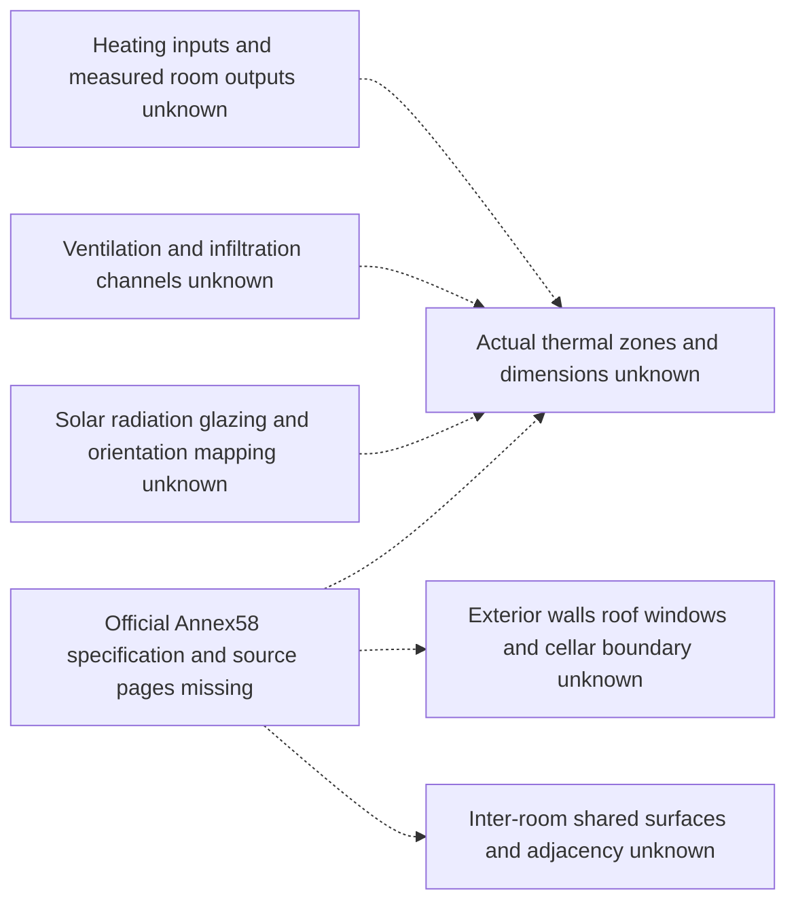

# C4.2 — Unresolved Annex58 topology

**No physical-zone diagram can yet be verified.** The official specification is
missing, so no actual room, partition, window or door adjacency is asserted.
In particular, the Annex71 N2 diagram must not be transferred to this experiment.

The Mermaid below is an **extraction dependency map only**, not the actual house
or an implemented thermal network. All dashed edges mean unresolved metadata,
not heat-flow paths. No verified room-to-room connection is presently available.

After authentic documentation is recovered, replace this dependency map with
source-cited **actual zones and connections**. Distinguish exterior heat transfer,
shared internal walls, solar gains, ventilation and room heating. Each shared wall
must appear once with both zone endpoints; separate door air mixing from solid
conduction. Verify floor/roof/cellar conditions instead of assuming adiabatic
boundaries. None of these heat-transfer paths is assigned to a room yet.

The machine-readable [scaffold](../configs/buildings/annex58_experiment1.json)
retains null geometry and empty surface/zone lists. This does not establish a
runnable multi-zone building. See [access/missing-input report](C42_DATASET_INSPECTION.md).
C4.3 implementation is not authorized by this incomplete topology.
